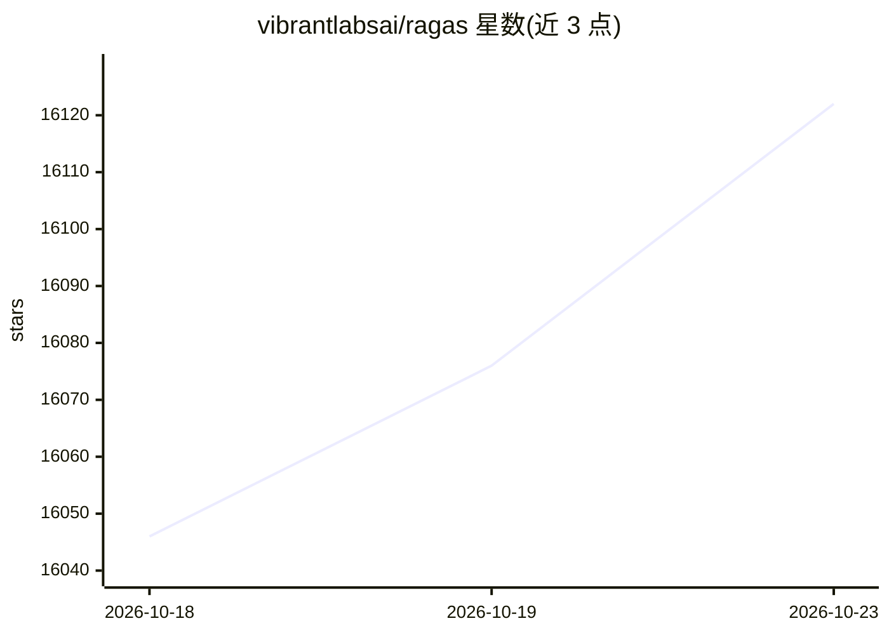

# vibrantlabsai/ragas

⭐ 16,122 · Python · Apache-2.0 · 推送 2026-02-24 · [GitHub](https://github.com/vibrantlabsai/ragas) · [官网](https://docs.ragas.io) · 组织维护

**为 LLM 应用提供评估指标与测试集生成的工具包**

Python 工具包，提供 LLM 应用的客观评估指标（含 LLM-based 与传统指标）、自动化测试数据生成与基于生产数据的反馈闭环。通过 pip 从 PyPI 或源码安装，附 ragas quickstart 命令可生成示例工程（rag_eval 评估 RAG 系统，agent_evals 等模板标注 Coming Soon）。与 LangChain 及主流可观测性工具集成，运行示例需设置 OPENAI_API_KEY。另提供咨询服务，并默认收集匿名使用数据（可通过 RAGAS_DO_NOT_TRACK 退出）。

## 筛选速览

| 维度 | 判定 | 备注 |
|---|---|---|
| AI 角色 | `ai-native` | 本体是模型或模型工具 |
| 许可风险 | `permissive` | Apache-2.0 |
| 部署形态 | `library` | 以包/库形式分发 |
| 模型依赖 | — | README 未给出锁定关系 |
| 硬件要求 | — | 无带数字的原话,不猜 |
| 安装摩擦 | `low` | 无编译、无系统依赖或容器化 |
| 成熟度 | — | 结构信号不足 |

## 动量与使用信号

- 维护:`declining` — 距上次 push 236.0 天,年发版 6,240 位贡献者
- 涨星:近 1 天 **+7**(自 20261016 起算)
- 安装:pypi 包 `ragas` 月下载 1,052,531

## 能力要点

- 提供 LLM-based 与传统两类评估指标
- 自动生成覆盖多场景的测试数据集
- 与 LangChain 及主流可观测性工具集成
- ragas quickstart 提供完整示例工程模板

## 适用场景

- 评估 RAG 系统的回答质量
- 为待评估的 LLM 应用自动生成测试集
- 利用生产数据构建持续改进的反馈闭环

## 场景标签

`模型评测` · 领域:评测与运维

## 证据(README 行号)

> L36: Objective metrics, intelligent test generation, and data-driven insights for LLM apps
> L38: Ragas is your ultimate toolkit for evaluating and optimizing Large Language Model (LLM) applications. Say goodbye t
> L45: - 🔗 Seamless Integrations: Works flawlessly with popular LLM frameworks like LangChain and major observability tool

## 星数曲线

2026-10-18 16,046 → 2026-10-23 16,122（+76）

---
*卡片 v1 · prompt 1.4 · 生成 2026-10-18 · 置信度 high · 依据 README sha `0a972661f64e` · [字段定义](../../DATASET.md)*
