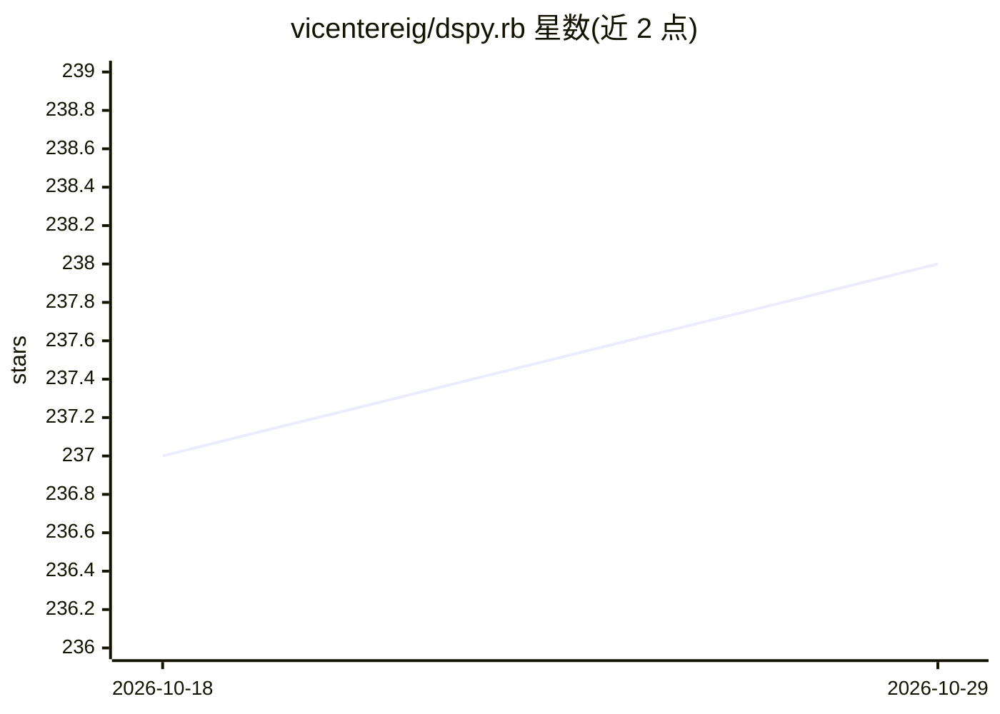

# vicentereig/dspy.rb

⭐ 238 · Ruby · NOASSERTION · 推送 2026-08-15 · [GitHub](https://github.com/vicentereig/dspy.rb) · [官网](https://oss.vicente.services/dspy.rb/) · 组织维护

**Ruby 版 DSPy：用类型化签名与模块编程 LLM，而非提示词**

将 DSPy 的签名、模块、Agent 与优化器模型引入 Ruby 的框架，附带 Sorbet 类型与 Ruby 原生集成。签名将任务声明为类型化输入输出，模块选择执行策略，用 Ruby 组合模块为程序；ReAct 在迭代边界内让模型选择下一步动作，由框架构建 provider 请求并校验返回结构。应用侧保留工具授权、副作用、预算与错误策略。1.x 为当前稳定版本线。

## 筛选速览

| 维度 | 判定 | 备注 |
|---|---|---|
| AI 角色 | `ai-ecosystem` | LLM/agent 周边工具 |
| 许可风险 | `none` | NOASSERTION |
| 部署形态 | `None` |  |
| 模型依赖 | — | README 未给出锁定关系 |
| 硬件要求 | — | 无带数字的原话,不猜 |
| 安装摩擦 | `low` | 无编译、无系统依赖或容器化 |
| 成熟度 | — | 结构信号不足 |

## 能力要点

- DSPy 签名/模块/ReAct Agent 模型的 Ruby 实现，带 Sorbet 类型
- 类型化任务契约替代输出模板，返回经过校验的 Ruby 值
- provider 适配器、优化器、可观测性导出器等以独立 gem 包分发
- 提供任务导向文档、按能力索引的示例与 llms.txt 参考

## 适用场景

- 在 Ruby/Rails 应用中构建类型化的模型调用程序
- 需要模型在有限迭代内选择工具的 ReAct Agent 场景
- 希望以编程方式组织 LLM 任务而非手写提示词的 Ruby 开发者

## 场景标签

`Agent 框架` `提示工程` · 领域:Agent 开发

## 证据(README 行号)

> L9: **Build typed agents and model-backed programs in Ruby.**
> L11: DSPy.rb brings DSPy's signature, module, agent, and optimizer model to Ruby, with Sorbet types and Ruby-native inte

## 星数曲线

2026-10-18 237 → 2026-10-29 238（+1）

---
*卡片 v1 · prompt 1.4 · 生成 2026-10-22 · 置信度 mid · 依据 README sha `753ccf7435df` · [字段定义](../../DATASET.md)*
