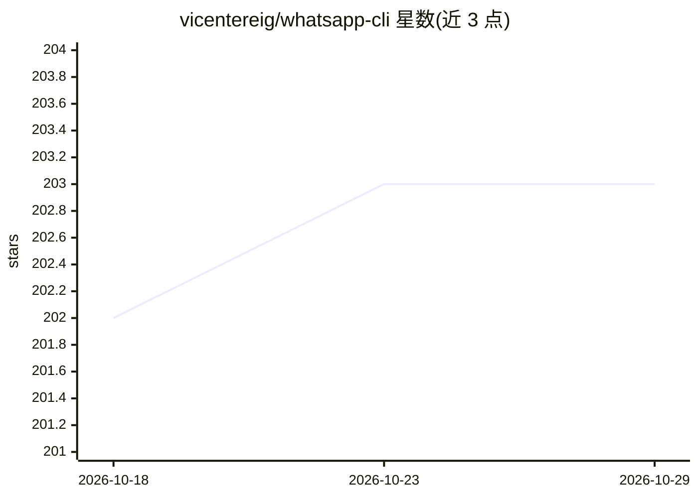

# vicentereig/whatsapp-cli

⭐ 203 · Go · 推送 2026-08-08 · [GitHub](https://github.com/vicentereig/whatsapp-cli) · [官网](https://oss.vicente.services/whatsapp-cli/) · 个人维护

**供人类与 LLM agent 使用的 WhatsApp 命令行工具**

基于 WhatsApp Web 多设备协议的独立命令行工具，用 Go 编写、编译为单一二进制。命令覆盖认证（QR 码扫码，会话约 20 天）、消息持续同步、消息列表/搜索、联系人搜索、聊天列表、发送文本消息与媒体下载；所有命令返回结构化 JSON。消息与会话存于本地 SQLite，无云端依赖。面向 Shell 脚本自动化、CI/CD、数据分析以及 Codex/Claude Code 等 AI 工具集成。安装支持 Homebrew、预编译二进制、源码构建和 go install。限制：send 仅支持文本，不返回送达/已读回执，sync 不下载媒体文件本体（仅存元数据）。

## 筛选速览

| 维度 | 判定 | 备注 |
|---|---|---|
| AI 角色 | `ai-ecosystem` | LLM/agent 周边工具 |
| 许可风险 | `none` | — |
| 部署形态 | `desktop` | 安装包/桌面程序 |
| 模型依赖 | — | README 未给出锁定关系 |
| 硬件要求 | — | 无带数字的原话,不猜 |
| 安装摩擦 | `low` | 无编译、无系统依赖或容器化 |
| 成熟度 | — | 结构信号不足 |

## 能力要点

- 单一 21MB 编译二进制，无运行时依赖
- 所有命令返回结构化 JSON 输出
- QR 码认证后本地 SQLite 持久会话，自动重连约 20 天
- 支持 Linux/macOS/Windows 的 x86_64 与 ARM64 预编译产物（含 SHA-256 与 Sigstore 签名校验）

## 适用场景

- 用 Shell 脚本或 cron 任务自动化收发 WhatsApp 消息
- 让 Codex/Claude Code 等 AI 工具读写我的 WhatsApp 对话
- 本地同步并搜索 WhatsApp 消息记录做数据分析

## 场景标签

 · 领域:通讯工具/开发者 CLI

## 证据(README 行号)

> L16: WhatsApp CLI is a standalone command-line tool for WhatsApp. It uses the WhatsApp Web multidevice protocol. Every c
> L19: - **AI Integration**: Codex, Claude Code, GPT-based tools

## 星数曲线

2026-10-18 202 → 2026-10-29 203（+1）

---
*卡片 v1 · prompt 1.4 · 生成 2026-10-22 · 置信度 high · 依据 README sha `5e5b95149089` · [字段定义](../../DATASET.md)*
