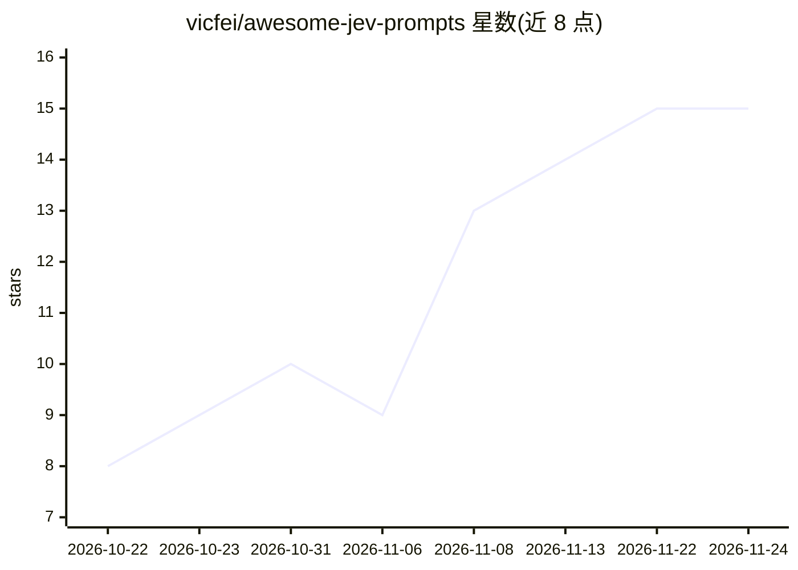

# vicfei/awesome-jev-prompts

⭐ 15 · Python · NOASSERTION · 推送 2026-11-23 · [GitHub](https://github.com/vicfei/awesome-jev-prompts) · 个人维护 · 中文 README

**Jev 类型化决策模型的提问模式与校准笔记策展清单**

面向 Jev 及 System One 兼容引擎（Clef、StartLux、d3、SGLang /v1/decisions 等）的问题设计模式库：收录 60 余条 Choice/Score/Noul 提问模式、反模式与校准笔记，按 10 个类别组织，含 linter 与引擎 cookbook，并提供中英双语版本。条目区分三类来源（官方文档、社区实践、推导实践），附阈值校准指引。另含引用项目排行榜与生态动态（每周自动刷新），提供 Python/TypeScript SDK 快速上手示例。

## 筛选速览

| 维度 | 判定 | 备注 |
|---|---|---|
| AI 角色 | `ai-knowledge` | 知识聚合/清单类 |
| 许可风险 | `none` | NOASSERTION |
| 部署形态 | `library` | 以包/库形式分发 |
| 模型依赖 | — | README 未给出锁定关系 |
| 硬件要求 | — | 无带数字的原话,不猜 |
| 安装摩擦 | `low` | 无编译、无系统依赖或容器化 |
| 成熟度 | — | 结构信号不足 |

## 能力要点

- 63 条提问模式条目，按 10 类组织（Choice/Score/Noul、路由、护栏、上下文压缩等）
- 10 条反模式条目与校准/评测指引（阈值拟合、影子模式、版本化问题）
- 条目分三档来源标注：Documented / Community-observed / Derived practice
- 引用 62 个 GitHub 项目的自动刷新排行榜与生态周报

## 适用场景

- 为 Jev/System One 引擎设计类型化决策问题
- 排查决策模型提问措辞的常见反模式
- 为生产系统的决策阈值做校准与评测
- 跟踪类型化决策模型生态的引擎与集成动态

## 场景标签

`提示工程` `精选清单` · 领域:Agent 开发

## 证据(README 行号)

> L3: > A curated library of question patterns, anti-patterns, and calibration notes for typed decision models — Jev and e
> L13: Jev returns typed answers — **Choice**, **Score**, **Noul** — with probabilities, in 70–500 ms. It never writes tex
> L77: ## The library — 63 entries in 10 categories

## 星数曲线

2026-10-22 8 → 2026-11-24 15（+7）

---
*卡片 v1 · prompt 1.4 · 生成 2026-11-18 · 置信度 mid · 依据 README sha `78399a3715e7` · [字段定义](../../DATASET.md)*
