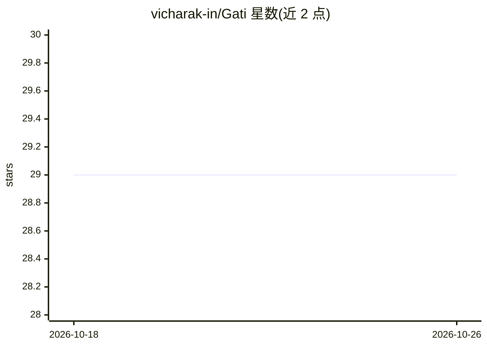

# vicharak-in/Gati

⭐ 29 · Verilog · GPL-2.0 · 推送 2026-06-12 · [GitHub](https://github.com/vicharak-in/Gati) · 组织维护

**面向 FPGA 的 CNN 硬件推理加速器（Verilog 实现）**

用 Verilog HDL 编写的 DNN 推理加速引擎，运行于 FPGA 可重构硬件，支持 Conv2D、全连接、池化、ReLU、INT8 量化等算子，可部署 VGG 类 CNN 与自定义量化网络，提供 ONNX 模型部署工作流。架构采用专用算子计算引擎、外部 DRAM 存储与流式数据流，通过分块与访存优化应对片上内存不足问题，设计目标为跨 FPGA 厂商可移植。项目处于活跃开发阶段，面向 FPGA 开发者与嵌入式机器学习部署场景；README 未给出安装运行命令，许可信息待公开发布时补充。

## 筛选速览

| 维度 | 判定 | 备注 |
|---|---|---|
| AI 角色 | `ai-ecosystem` | LLM/agent 周边工具 |
| 许可风险 | `viral` | GPL-2.0 |
| 部署形态 | `None` |  |
| 模型依赖 | — | README 未给出锁定关系 |
| 硬件要求 | — | 无带数字的原话,不猜 |
| 安装摩擦 | `low` | 无编译、无系统依赖或容器化 |
| 成熟度 | `idea` | |

## 能力要点

- 全 Verilog 实现的 FPGA 原生 DNN 推理加速
- INT8 量化推理与 Conv2D/全连接/池化等算子支持
- ONNX 模型部署工作流
- 厂商无关设计，面向资源受限 FPGA 并可扩展至更大平台

## 适用场景

- 在 FPGA 上加速 CNN 模型推理部署
- 资源受限/功耗敏感场景下运行量化 CNN
- 跨 FPGA 厂商移植机器学习加速方案

## 场景标签

`推理引擎` · 领域:训练与推理

## 证据(README 行号)

> L3: **Gati** is a hardware-accelerated Deep Neural Network (DNN) inference engine designed specifically for FPGA platfor
> L5: Built entirely in Verilog, Gati provides a flexible and efficient framework for accelerating machine learning worklo

## 星数曲线

2026-10-18 29 → 2026-10-26 29（+0）

---
*卡片 v1 · prompt 1.4 · 生成 2026-10-26 · 置信度 high · 依据 README sha `630a109be23c` · [字段定义](../../DATASET.md)*
