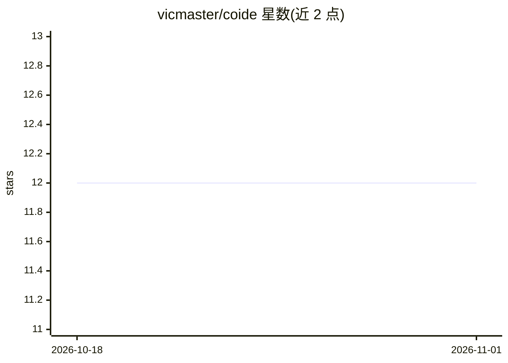

# vicmaster/coide

⭐ 12 · TypeScript · MIT · 推送 2026-10-18 · [GitHub](https://github.com/vicmaster/coide) · 个人维护

**Claude Code CLI 的 Electron 桌面 GUI 客户端**

用 Electron、React、TypeScript 构建的桌面 GUI，包装已有的 Claude Code CLI：同一账号与订阅，无需 API key。通过 node-pty 提供真实 TTY 与 CLI 交互。功能含多会话管理、模型/推理力度切换、工具权限对话框与 Monaco diff 审阅、子 Agent 与任务面板、React Flow 可视化工作流、集成终端、技能编辑器等。前置条件为已安装并认证的 Claude Code CLI、Node.js 20+，主要面向 macOS（Linux/Windows 需自行调整），从源码克隆构建运行。

## 筛选速览

| 维度 | 判定 | 备注 |
|---|---|---|
| AI 角色 | `ai-ecosystem` | LLM/agent 周边工具 |
| 许可风险 | `permissive` | MIT |
| 部署形态 | `desktop` | 安装包/桌面程序 |
| 模型依赖 | — | README 未给出锁定关系 |
| 硬件要求 | — | 无带数字的原话,不猜 |
| 安装摩擦 | `low` | 无编译、无系统依赖或容器化 |
| 成熟度 | — | 结构信号不足 |

## 能力要点

- 通过 node-pty 包装 Claude Code CLI，同账号订阅、无需 API key
- 工具权限对话框 + Monaco diff 审阅与拒绝自动回滚
- React Flow 可视化工作流（触发器含 cron/webhook/文件监听）
- 子 Agent 层级、token/成本、速率限制实时面板

## 适用场景

- 在图形界面中使用我已有的 Claude Code 订阅
- 审阅并接受/拒绝 Claude 的文件编辑
- 用可视化画布编排链式 Claude 工作流

## 场景标签

`AI 助手` · 领域:对话与助手

## 证据(README 行号)

> L7: A desktop GUI client for Claude Code that wraps the CLI you already use — same account, same subscription, no API ke
> L9: Built with Electron, React, and TypeScript. Talks to Claude through `node-pty`, giving it a real TTY so everything w

## 星数曲线

2026-10-18 12 → 2026-11-01 12（+0）

---
*卡片 v1 · prompt 1.4 · 生成 2026-10-31 · 置信度 high · 依据 README sha `6d466a36aee1` · [字段定义](../../DATASET.md)*
