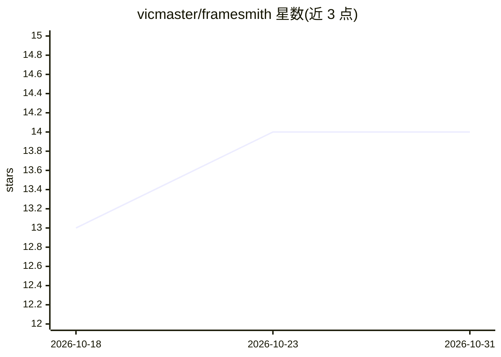

# vicmaster/framesmith

⭐ 14 · TypeScript · MIT · 推送 2026-10-23 · [GitHub](https://github.com/vicmaster/framesmith) · 个人维护

**MCP 服务器：让 AI 编码代理产出经质量门把关的 UI 设计**

面向 AI 编码代理的 MCP 服务器，把 UI 设计前置到写代码之前：代理从 11 个经过回归测试的页面模式出发，基于场景图生成 HTML/CSS，经 canvas_evaluate 评分（含陈词滥调检测、状态覆盖、可用性检查）达到 READY 后再交付。设计以开放 JSON 持久化到仓库，可用 npx 启动浏览器 viewer 审阅、评论，支持从 HTML/URL 反向导入与 CI 漂移检查，兼容任意 MCP 客户端。

## 筛选速览

| 维度 | 判定 | 备注 |
|---|---|---|
| AI 角色 | `ai-ecosystem` | LLM/agent 周边工具 |
| 许可风险 | `permissive` | MIT |
| 部署形态 | `library` | 以包/库形式分发 |
| 模型依赖 | — | README 未给出锁定关系 |
| 硬件要求 | — | 无带数字的原话,不猜 |
| 安装摩擦 | `low` | 无编译、无系统依赖或容器化 |
| 成熟度 | — | 结构信号不足 |

## 能力要点

- 11 个页面模式库，回归测试得分 >95 且零陈词滥调特征
- canvas_evaluate 质量门（8 类评分 + READY/NOT READY 指令）与 canvas_autofix 自纠正
- 设计持久化为开放 JSON，可从已发布 HTML 重新导入
- generate_design_system 由一个种子色 + 风格人格生成完整设计语言（含 AA 对比与暗色主题）

## 适用场景

- 让 Claude Code / Cursor 等编码代理先产出并通过质量门的 UI 设计再写框架代码
- 在浏览器 viewer 中审阅画布、按断点比对并给出点到元素的反馈
- 在 CI/pre-commit 中用 CLI 检查设计与代码的漂移

## 场景标签

 · 领域:开发工具/UI 设计

## 证据(README 行号)

> L5: An open-source MCP server that turns your AI coding agent into a capable UI designer. It gives the agent a visual ca
> L28: MCP Client → stdio → framesmith server
> L54: |**Open by design**|MIT · plain HTML/CSS · open JSON you own in your repo · content-hash versioning (`canvas_versio

## 星数曲线

2026-10-18 13 → 2026-10-31 14（+1）

---
*卡片 v1 · prompt 1.4 · 生成 2026-10-31 · 置信度 high · 依据 README sha `ce3f3e207a2e` · [字段定义](../../DATASET.md)*
