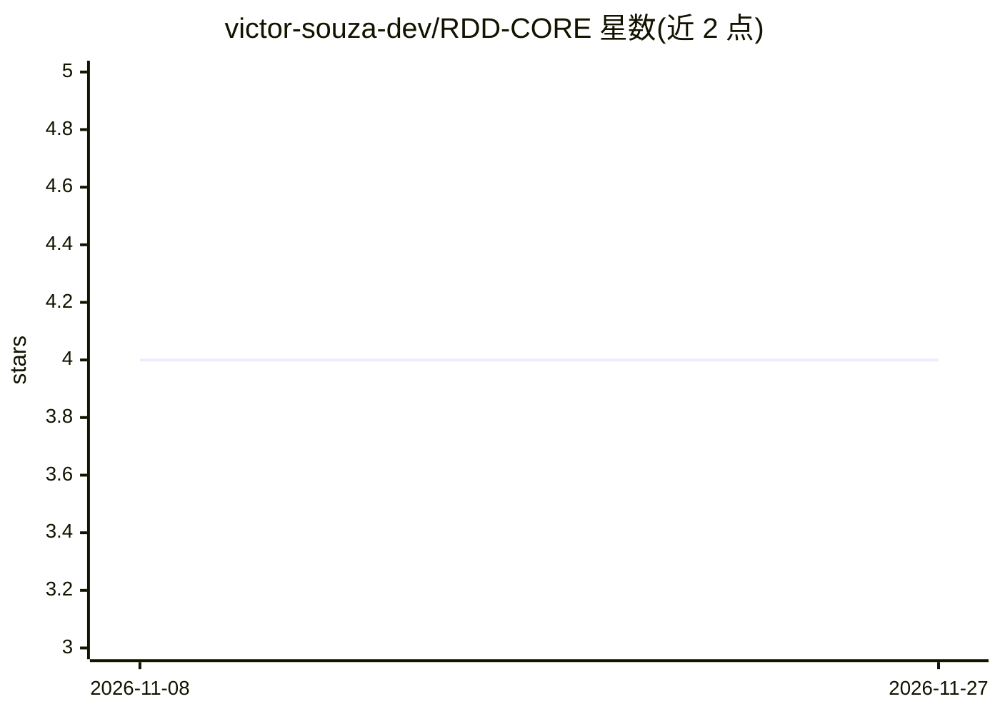

# victor-souza-dev/RDD-CORE

⭐ 4 · JavaScript · Apache-2.0 · 推送 2026-11-03 · [GitHub](https://github.com/victor-souza-dev/RDD-CORE) · 组织维护

**面向 OpenCode 的需求到代码可追溯 AI 工作流引擎**

以 OpenCode 为运行环境的开源核心工作流：四个主 agent 覆盖需求、文档、开发、DevOps，配 25 个子 agent 与 78 个技能，把业务需求整理为带稳定 ID 的 REQUIREMENTS.md，再生成数据模型、API 契约、用户故事等工件。采用三层结构（CORE/PACK/PROFILE）分离通用引擎与组织私有内容，通过 fork+PR 向上游贡献通用改进，CI 中立性门禁扫描提交内容。安装方式为 git clone 到 OpenCode 配置目录。

## 筛选速览

| 维度 | 判定 | 备注 |
|---|---|---|
| AI 角色 | `ai-ecosystem` | LLM/agent 周边工具 |
| 许可风险 | `permissive` | Apache-2.0 |
| 部署形态 | `None` |  |
| 模型依赖 | — | README 未给出锁定关系 |
| 硬件要求 | — | 无带数字的原话,不猜 |
| 安装摩擦 | `low` | 无编译、无系统依赖或容器化 |
| 成熟度 | — | 结构信号不足 |

## 能力要点

- 4 个主 agent + 25 个子 agent + 78 个技能的工作流组件体系
- 需求→技术翻译→质量的分阶段可追溯工件（RN-XXX/PEND-XXX 稳定 ID）
- 三层内容优先级 PROFILE > PACK > CORE 的 open-core 架构
- CI 中立性门禁扫描匿名化与客户内容隔离

## 适用场景

- 把会议与业务需求沉淀为可追溯的需求文档与技术工件
- 对既有系统做多仓库逆向工程并生成技术文档
- 为组织搭建带私有规则包的规范驱动开发流程

## 场景标签

`工作流自动化` `编码 Agent` `多智能体` · 领域:Agent 开发

## 证据(README 行号)

> L8: **RDD (Requirements, Documentation, Development)** is an open-core, context
> L39: - **Primary agents (RDD Quadri)** — the active persona of your OpenCode

## 星数曲线

2026-11-08 4 → 2026-11-27 4（+0）

---
*卡片 v1 · prompt 1.4 · 生成 2026-11-21 · 置信度 high · 依据 README sha `4c6c68df1bbe` · [字段定义](../../DATASET.md)*
