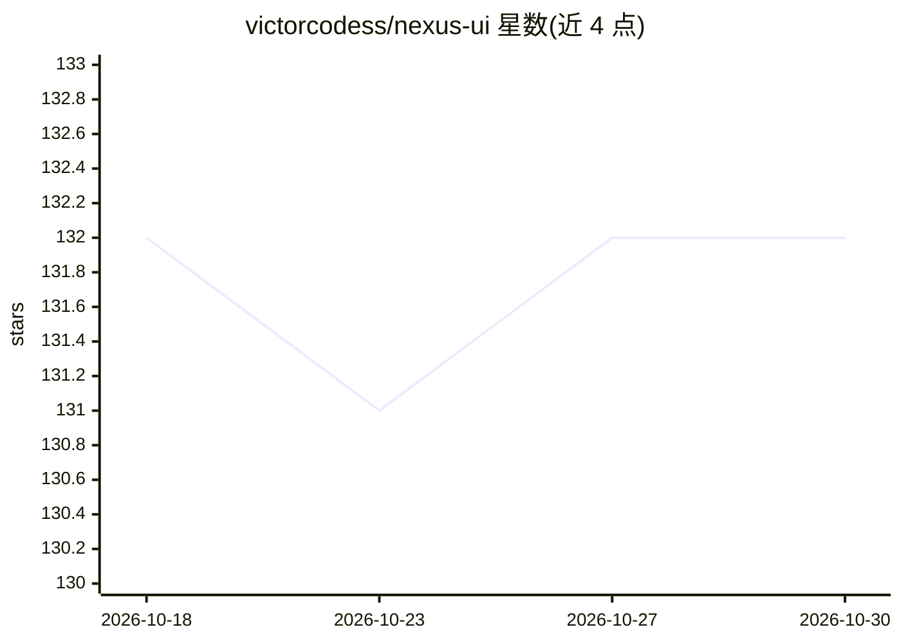

# victorcodess/nexus-ui

⭐ 132 · TypeScript · MIT · 推送 2026-06-16 · [GitHub](https://github.com/victorcodess/nexus-ui) · [官网](https://nexus-ui.dev) · 个人维护

**面向 AI 应用的 React 组件库，shadcn/ui 风格可复制源码**

开源 React 组件库，为 AI 交互界面提供可组合的基础组件：PromptInput、Thread、Message、ModelSelector、Attachments、Citation、Reasoning、ChainOfThought、Tool、Questions 等，覆盖流式、语音、多模态与 agent 界面场景。设计上要求项目先初始化 shadcn/ui，通过 shadcn CLI、直接 URL 或 nexus-ui-cli 复制组件到项目中，代码归使用者所有。README 提及与 Vercel AI SDK、ElevenLabs 等 AI 服务集成。MIT 许可。

## 筛选速览

| 维度 | 判定 | 备注 |
|---|---|---|
| AI 角色 | `ai-ecosystem` | LLM/agent 周边工具 |
| 许可风险 | `permissive` | MIT |
| 部署形态 | `library` | 以包/库形式分发 |
| 模型依赖 | — | README 未给出锁定关系 |
| 硬件要求 | — | 无带数字的原话,不猜 |
| 安装摩擦 | `low` | 无编译、无系统依赖或容器化 |
| 成熟度 | — | 结构信号不足 |

## 能力要点

- 15+ 个面向 AI 场景的可组合组件（聊天输入/线程/引用/推理轨迹/工具调用 UI 等）
- 组件通过 shadcn registry 复制进项目，代码归开发者
- 支持自定义 registry 配置（@nexus-ui scope）

## 适用场景

- 为 LLM 聊天/agent 应用快速搭建界面
- 展示模型推理轨迹、工具调用与引用来源的 UI
- 在已有 shadcn/ui 项目中补充 AI 专用组件

## 场景标签

 · 领域:前端/AI 界面组件

## 证据(README 行号)

> L9: Nexus UI is an open-source component library for building AI-powered interfaces. It provides a set of composable pri
> L13: Instead of adapting general-purpose components for AI use cases, Nexus UI is designed from the ground up for stream

## 星数曲线

2026-10-18 132 → 2026-10-30 132（+0）

---
*卡片 v1 · prompt 1.4 · 生成 2026-10-22 · 置信度 high · 依据 README sha `98a6d4753e45` · [字段定义](../../DATASET.md)*
