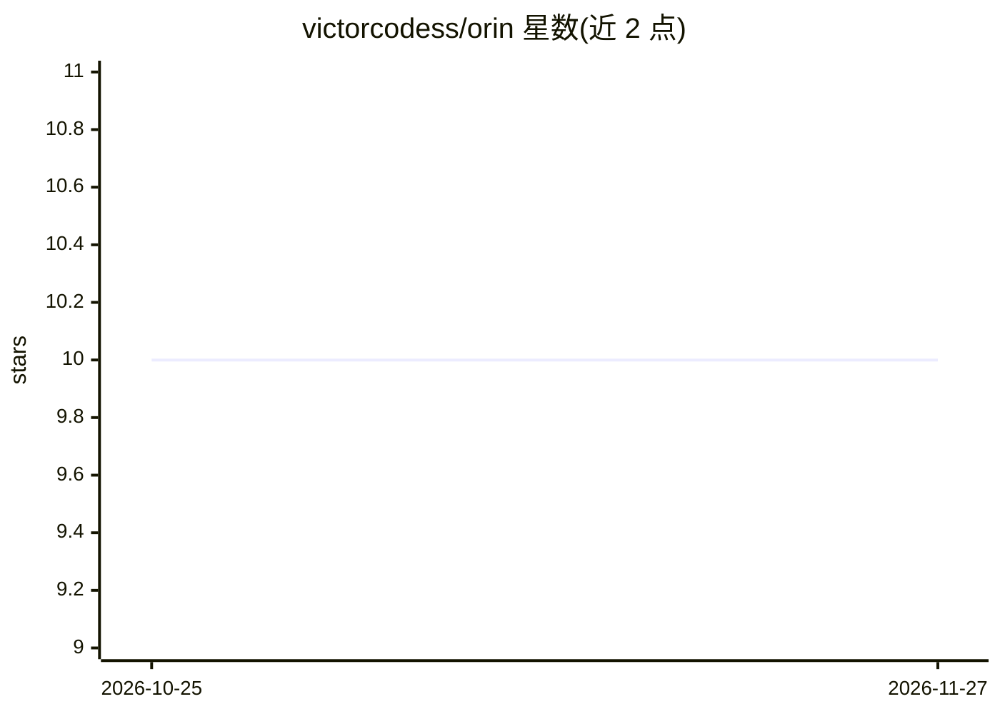

# victorcodess/orin

⭐ 10 · TypeScript · MIT · 推送 2026-07-14 · [GitHub](https://github.com/victorcodess/orin) · [官网](https://orin.chat) · 个人维护

**可打字可语音通话的开源 AI 陪伴助手**

Orin 是一个语音 AI 伴侣应用：文本聊天与语音通话共用同一套 AI 逻辑、人格配置与消息线程，同一用户两种入口得到一致的对话体验。技术栈为 Next.js + Vercel AI SDK + Supabase（Google OAuth、Postgres、RLS），文本对话走 OpenAI，语音由 ElevenLabs Speech Engine 经 WebRTC 提供，实时音频由独立 Node WebSocket sidecar 承载（因 serverless 不适合持久连接）。无支付系统，采用平台额度 + 用户自带 API 密钥（BYOK，静态加密）的配额机制；匿名用户可在浏览器中试用少量额度，登录后解锁语音通话与朗读、跨设备同步。部署需自备 Supabase、OpenAI、ElevenLabs 与 Google OAuth 凭据。

## 筛选速览

| 维度 | 判定 | 备注 |
|---|---|---|
| AI 角色 | `ai-native` | 本体是模型或模型工具 |
| 许可风险 | `permissive` | MIT |
| 部署形态 | `library` | 以包/库形式分发 |
| 模型依赖 | — | README 未给出锁定关系 |
| 硬件要求 | — | 无带数字的原话,不猜 |
| 安装摩擦 | `low` | 无编译、无系统依赖或容器化 |
| 成熟度 | — | 结构信号不足 |

## 能力要点

- 文本聊天与语音通话共享同一 AI 逻辑与消息线程
- 语音经 ElevenLabs Speech Engine + WebRTC，由 Node WebSocket sidecar 承载
- 平台额度 + BYOK：用户可添加自己的 OpenAI/ElevenLabs 密钥（静态加密）
- 66 个单元测试覆盖配额、BYOK 加密、认证重定向与消息净化，CI 覆盖 PR 与 push

## 适用场景

- 自部署一个可语音通话的 AI 陪伴应用
- 安静时打字、开口时语音通话的同一对话线程
- 不想接入支付计费、靠配额加 BYOK 控制成本的个人部署

## 场景标签

`AI 助手` `聊天机器人` `语音 Agent` · 领域:对话与助手

## 证据(README 行号)

> L5: Orin is a voice-enabled AI companion built for **conversation**. Type when you want to think quietly, or start a voi
> L11: - **One assistant, one brain, two surfaces** — text chat and voice calls share the same AI logic, personality confi
> L26: |Text chat|OpenAI via AI SDK|

## 星数曲线

2026-10-25 10 → 2026-11-27 10（+0）

---
*卡片 v1 · prompt 1.4 · 生成 2026-11-19 · 置信度 high · 依据 README sha `3948fe72a6d4` · [字段定义](../../DATASET.md)*
