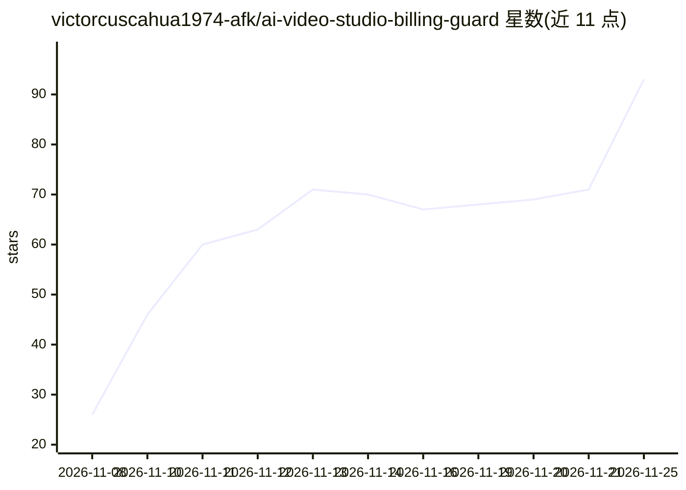

# victorcuscahua1974-afk/ai-video-studio-billing-guard

⭐ 93 · 推送 2026-11-03 · [GitHub](https://github.com/victorcuscahua1974-afk/ai-video-studio-billing-guard) · [官网](https://app.coregold.io/signup?invite_code=ADvlj9b) · 组织维护 · 中文 README

**面向 AI 视频工作室的虚拟卡开卡推广页（CoreGold）**

仓库内容为 CoreGold 虚拟卡服务的推广文案，非软件代码：面向使用 Sora、Runway Gen-3、Midjourney 订阅的视频工作室，宣传独立企业卡段结算、一号一卡隔离多账号、限额拦截自动续订与销卡退款等流程。接入方式为登录 CoreGold 控制台充入 USDT 换 USD 后开卡绑卡，仓库内无代码、无安装或运行说明，文末附哈希字符串与开卡链接。

## 筛选速览

| 维度 | 判定 | 备注 |
|---|---|---|
| AI 角色 | `ai-enhanced` | 去掉 AI 部分产品仍成立 |
| 许可风险 | `none` | — |
| 部署形态 | `None` |  |
| 模型依赖 | — | README 未给出锁定关系 |
| 硬件要求 | — | 无带数字的原话,不猜 |
| 安装摩擦 | `low` | 无编译、无系统依赖或容器化 |
| 成熟度 | — | 结构信号不足 |

## 能力要点

- 宣传为每个矩阵账号分配独立虚拟卡号以隔离账单
- 宣传卡台限额拦截自动续订与一键销卡退款流程
- 接入流程为 CoreGold 控制台注资（USDT 转 USD）后开卡

## 适用场景

- 为多个 AI 视频平台账号分别绑定独立虚拟卡
- 项目结束后通过限额或销卡停止订阅续费

## 场景标签

 · 领域:支付/虚拟卡服务

## 证据(README 行号)

> L12: * **独立 Commercial BIN 结算**：CoreGold 提供高信誉海外企业卡段，天然支持大额跨国数字商品结算，抗风控拦截。
> L18: 1. **注资**：登录 CoreGold 控制台 充入 USDT，秒转 USD 资金。

## 星数曲线

2026-11-08 26 → 2026-11-25 93（+67）

---
*卡片 v1 · prompt 1.4 · 生成 2026-11-18 · 置信度 low · 依据 README sha `e15ebadc21d1` · [字段定义](../../DATASET.md)*
