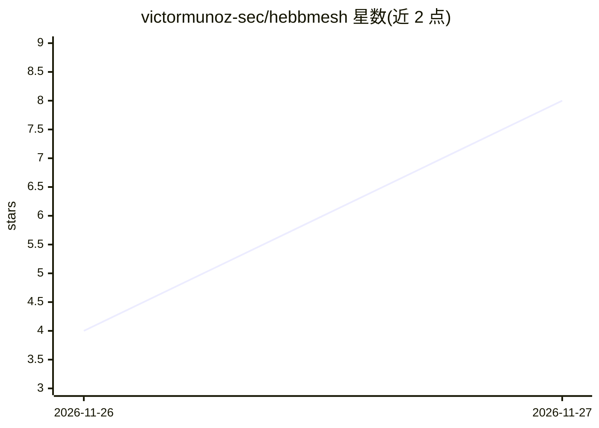

# victormunoz-sec/hebbmesh

⭐ 8 · JavaScript · AGPL-3.0 · 推送 2026-11-25 · [GitHub](https://github.com/victormunoz-sec/hebbmesh) · 个人维护 · 中文 README

**为 AI Agent 提供零嵌入、零 LLM 调用的 Markdown 记忆引擎**

基于纯 Markdown 文件与 Node.js 原生 node:sqlite（WAL 模式）构建的确定性记忆引擎（v1.7）：检索在普通 CPU 上低于 6 ms 完成，不调用嵌入模型或 LLM。写入时通过 `| sem:` 后缀由捕获记忆的 LLM 追加 3–5 个同义词实现语义播种；提供 3D A* 跨主题路径（bridge）、私人保险库隐私防火墙、每周情节固化等机制。在 LoCoMo-10、CMI 反投毒红队、Suite B 等基准上给出与 BM25/SQLite FTS5 的对比数据。仅需 Node.js >= 22.5，无 npm 依赖、无 Docker、无 API key，支持 CLI 与 3 行 Node.js 嵌入。

## 筛选速览

| 维度 | 判定 | 备注 |
|---|---|---|
| AI 角色 | `ai-ecosystem` | LLM/agent 周边工具 |
| 许可风险 | `dual` | AGPL-3.0 |
| 部署形态 | `library` | 以包/库形式分发 |
| 模型依赖 | local-ok | 支持本地模型 |
| 硬件要求 | — | 无带数字的原话,不猜 |
| 安装摩擦 | `low` | 无编译、无系统依赖或容器化 |
| 成熟度 | — | 结构信号不足 |

## 能力要点

- 零嵌入、零 LLM 调用、0 npm 依赖，CPU 检索 <6 ms
- 写入时 `| sem:` 语义播种替代嵌入模型
- graph 层隐私防火墙隔离 private_vault.md 节点
- 3D A* bridge 发现跨主题最短路径；附 3D 本地查看器

## 适用场景

- 给 Claude Code/Cursor 等 agent 会话的 SessionStart hook 注入相关历史记忆
- 在本地 Markdown 笔记库上做毫秒级语义化检索
- 需要隐私隔离的 agent 记忆存储（私人节点不出现在检索与图路径中）
- 离线环境下的 LLM 长期记忆方案

## 场景标签

`Agent 记忆` `RAG` · 领域:Agent 开发

## 证据(README 行号)

> L8: > **What is HebbMesh?** Most AI agent memory stacks either dump raw Markdown into your prompt (burning tokens) or fo
> L60: # CLI (great for Claude Code, Cursor, OpenCode, or Antigravity SessionStart hooks):
> L71: const mem = activateNetwork('./my-memory', userMessage, { topK: 5 });

## 星数曲线

2026-11-26 4 → 2026-11-27 8（+4）

---
*卡片 v1 · prompt 1.4 · 生成 2026-11-26 · 置信度 mid · 依据 README sha `0cbe7173e9f2` · [字段定义](../../DATASET.md)*
