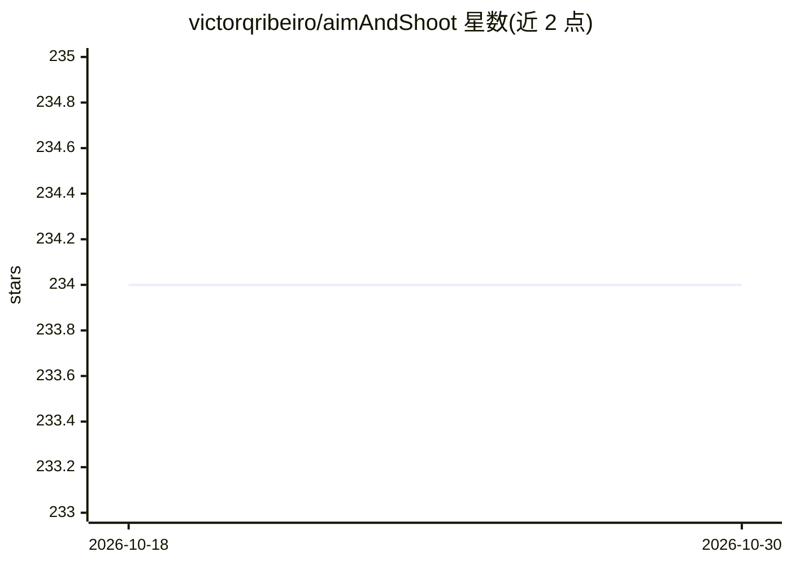

# victorqribeiro/aimAndShoot

⭐ 234 · JavaScript · MIT · 推送 2026-10-10 · [GitHub](https://github.com/victorqribeiro/aimAndShoot) · [官网](https://victorribeiro.com/aimAndShoot) · 个人维护

**神经进化射击小游戏：敌人由遗传算法进化的神经网络控制**

JavaScript/Canvas 编写的浏览器射击游戏与神经进化实验：每个机器人由独立神经网络控制，全部死亡后按命中数、失误、误伤队友、自伤与移动量计算适应度，遗传算法交叉繁衍下一代。2026 版修复并扩展了进化机制，改由 PHP+SQLite 服务器维护共享种群，所有玩家共同参与进化，服务器不可达时回退为本地进化。玩家用 WASD 移动、鼠标瞄准射击，作者提示不建议移动端使用。

## 筛选速览

| 维度 | 判定 | 备注 |
|---|---|---|
| AI 角色 | `ai-native` | 本体是模型或模型工具 |
| 许可风险 | `permissive` | MIT |
| 部署形态 | `None` |  |
| 模型依赖 | — | README 未给出锁定关系 |
| 硬件要求 | — | 无带数字的原话,不猜 |
| 安装摩擦 | `low` | 无编译、无系统依赖或容器化 |
| 成熟度 | — | 结构信号不足 |

## 能力要点

- 每个机器人由独立神经网络控制，用遗传算法按适应度交叉进化
- 共享进化：服务器（PHP+SQLite）维护种群，全体玩家共同繁衍机器人
- 服务器不可达时回退为本地进化
- 2026 版修复进化缺陷：保留每代最优个体、变异细调而非打乱、适应度不再奖励乱射

## 适用场景

- 在浏览器中体验与进化中的神经网络机器人对战
- 观察神经进化在对抗玩家过程中的行为变化

## 场景标签

 · 领域:游戏/机器学习实验

## 证据(README 行号)

> L41: Each bot is controlled by it's own Neural Network (that I made a while back - here). When all the bots die, the gen
> L52: - **Shared evolution.** The bots are no longer reset when you die. They come from one population kept on the server

## 星数曲线

2026-10-18 234 → 2026-10-30 234（+0）

---
*卡片 v1 · prompt 1.4 · 生成 2026-10-22 · 置信度 high · 依据 README sha `b143cf5c3ea7` · [字段定义](../../DATASET.md)*
