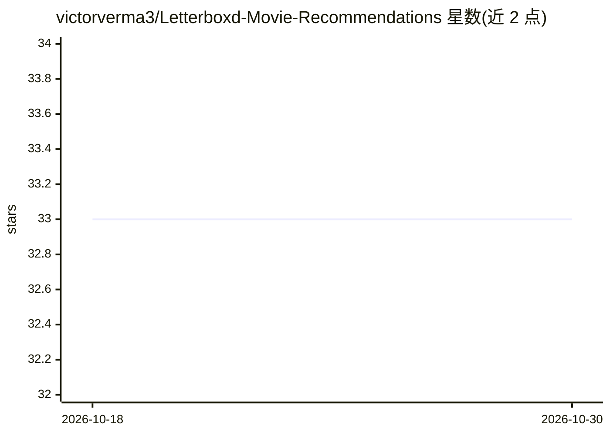

# victorverma3/Letterboxd-Movie-Recommendations

⭐ 33 · Jupyter Notebook · MIT · 推送 2026-02-13 · [GitHub](https://github.com/victorverma3/Letterboxd-Movie-Recommendations) · [官网](https://recommendations.victorverma.com/) · 个人维护

**基于 Letterboxd 个人评分的电影推荐 Web 应用**

用户输入 Letterboxd 用户名后，网站抓取其评分与 10 万+ 电影特征数据，用随机森林（content-based filtering）训练个性化模型，生成电影推荐、预测评分、观影清单挑选，以及双人影味契合度分析（偏好向量余弦相似度、类型多边形重叠率、年代 L1 距离）。自然语言筛选条件通过 OpenAI GPT-5 Nano 解析。注意：2026 年 1 月网站因 Letterboxd 服务条款更新已无限期关停，README 未提供本地部署说明。

## 筛选速览

| 维度 | 判定 | 备注 |
|---|---|---|
| AI 角色 | `ai-native` | 本体是模型或模型工具 |
| 许可风险 | `permissive` | MIT |
| 部署形态 | `None` |  |
| 模型依赖 | — | README 未给出锁定关系 |
| 硬件要求 | — | 无带数字的原话,不猜 |
| 安装摩擦 | `low` | 无编译、无系统依赖或容器化 |
| 成熟度 | — | 结构信号不足 |

## 能力要点

- 每次请求基于用户自身评分训练随机森林模型生成推荐
- GPT-5 Nano 解析自然语言描述生成推荐筛选条件
- 支持多用户共同推荐（取重叠影片并平均预测评分）
- 双人契合度含影片/类型/年代三个维度评分与共同最爱、分歧影片

## 适用场景

- 根据自己在 Letterboxd 的评分记录获得电影推荐
- 和朋友对比影味契合度、找共同想看的电影
- 从自己的 Letterboxd 观影清单中挑选下一部

## 场景标签

`推荐系统` · 领域:学习与行业

## 证据(README 行号)

> L46: The user inputs their Letterboxd username and the website generates movie
> L142: A new random forest model is trained each time the user inputs their username.
> L152: is then processed using OpenAI's GPT-5 Nano to produce filters that match the

## 星数曲线

2026-10-18 33 → 2026-10-30 33（+0）

---
*卡片 v1 · prompt 1.4 · 生成 2026-10-25 · 置信度 high · 依据 README sha `edb920a01b74` · [字段定义](../../DATASET.md)*
