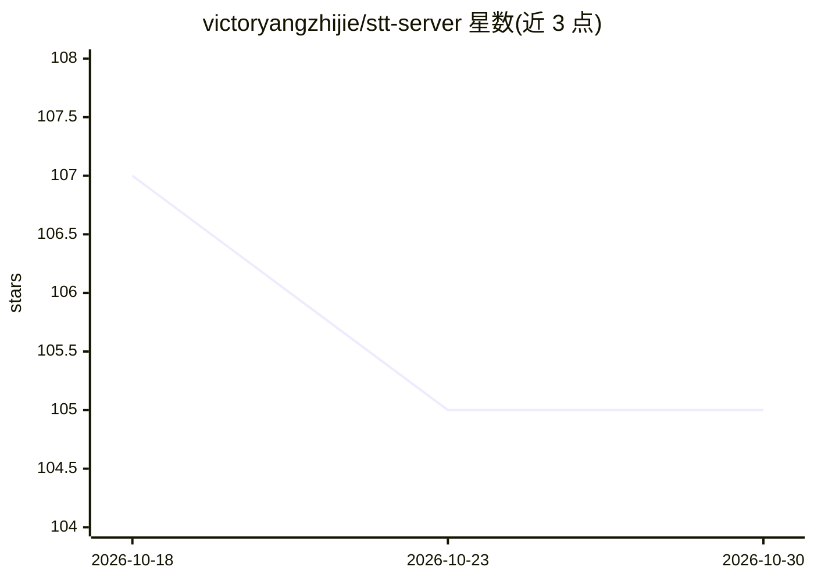

# victoryangzhijie/stt-server

⭐ 105 · Python · Apache-2.0 · 推送 2026-09-14 · [GitHub](https://github.com/victoryangzhijie/stt-server) · 个人维护

**实时语音转文字服务端：可插拔 ASR 后端与 OpenAI 兼容接口**

面向研究与生产场景的实时语音转文字 WebSocket/HTTP 服务系统：在协议无关核心（VAD → 端点检测 → 各后端流式解码 → 转写稳定化）之上提供 OpenAI 兼容接口，支持 mock、sherpa-onnx、FunASR、Qwen3-ASR、Nemotron 五个可插拔后端，各后端运行在各自的执行策略下。提供 Docker CPU/GPU compose 配置、Prometheus+Grafana 可观测性、基准测试工具与 325 项测试。Nemotron 后端已编写但未在真实硬件运行，GPU 数值 WER 为待完成项。

## 筛选速览

| 维度 | 判定 | 备注 |
|---|---|---|
| AI 角色 | `ai-ecosystem` | LLM/agent 周边工具 |
| 许可风险 | `permissive` | Apache-2.0 |
| 部署形态 | `self-host` | docker 或自建部署 |
| 模型依赖 | local-ok | 支持本地模型 |
| 硬件要求 | — | 无带数字的原话,不猜 |
| 安装摩擦 | `low` | 无编译、无系统依赖或容器化 |
| 成熟度 | `idea` | |

## 能力要点

- 五个可插拔开源 ASR 后端，各配独立执行策略
- 三种协议适配器（原生 WS、OpenAI Realtime 风格 WS、OpenAI 文件式 HTTP）共享同一核心
- Prometheus 指标 + 预配置 Grafana 面板的可观测性
- 基准测试工具链：WER、延迟、负载、稳定化与端点检测，单命令可复现

## 适用场景

- 部署自托管的实时流式语音转文字服务
- 按需切换或对比不同开源 ASR 后端
- 以 OpenAI 兼容接口接入现有语音转写客户端
- 监控转写服务的会话数、延迟分位与错误率

## 场景标签

`语音识别` `推理引擎` · 领域:感知与多模态

## 证据(README 行号)

> L4: system: an OpenAI-compatible WebSocket/HTTP surface in front of a
> L6: transcript stabilization), with five pluggable open-source ASR backends
> L27: |Qwen3-ASR|`qwen3asr`|`qwen3asr`|bounded `ThreadPoolExecutor` (vLLM's sync `LLM`, not an async engine)|real model, 

## 星数曲线

2026-10-18 107 → 2026-10-30 105（-2）

---
*卡片 v1 · prompt 1.4 · 生成 2026-10-23 · 置信度 high · 依据 README sha `c2f0b448b892` · [字段定义](../../DATASET.md)*
