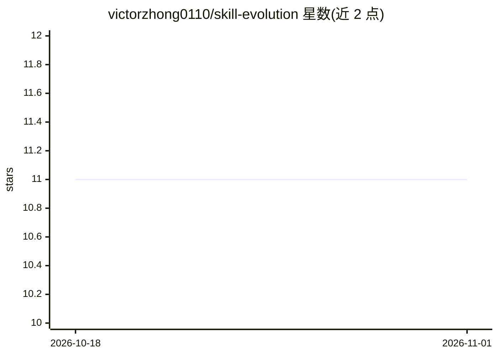

# victorzhong0110/skill-evolution

⭐ 11 · Python · MIT · 推送 2026-09-20 · [GitHub](https://github.com/victorzhong0110/skill-evolution) · [官网](https://pypi.org/project/skill-evolution/) · 个人维护

**通过对比循环迭代优化 AI agent 技能（SKILL.md）的 CLI 工具**

面向使用 Claude Code 等 agent 的开发者的 Python CLI：读取 Agent Skills 目录或单个 SKILL.md，基于成功/失败轨迹的对比信号生成补丁，用保留集门控拒绝过拟合补丁，支持 DELETE/DEMOTE 收缩操作，并提供 audit、history、rollback 与 init 配置命令。LLM 后端可选 claude/openai/cli/bridge，claude-code CLI 方式无需 API key。随附脚本非沙箱：以宿主子进程运行，路径限定在 scripts/ 下，约 30 秒超时，无 Docker 隔离。任务需提供评分标准或配置评估器，否则 evolve 以退出码 2 退出。

## 筛选速览

| 维度 | 判定 | 备注 |
|---|---|---|
| AI 角色 | `ai-ecosystem` | LLM/agent 周边工具 |
| 许可风险 | `permissive` | MIT |
| 部署形态 | `library` | 以包/库形式分发 |
| 模型依赖 | locked-api |  |
| 硬件要求 | — | 无带数字的原话,不猜 |
| 安装摩擦 | `low` | 无编译、无系统依赖或容器化 |
| 成熟度 | — | 结构信号不足 |

## 能力要点

- 对比式更新：从成功/失败轨迹提取改进信号
- 保留集（held-out）门控回滚导致分数下降的补丁
- DELETE/DEMOTE 为一等操作，拒绝只增不减的补丁
- 提供 evolve/audit/history/rollback/init 五个 CLI 命令

## 适用场景

- 改进我自己写 agent 技能（SKILL.md）的质量
- 审计技能是否存在过拟合或静默绕过问题
- 查看技能版本历史并回滚到之前版本

## 场景标签

`提示工程` · 领域:Agent 开发

## 证据(README 行号)

> L8: > Evolve Agent Skills (`SKILL.md`) through a contrastive loop with a held-out gate.
> L166: ├── cli.py              # CLI commands (evolve, audit, history, rollback, init)

## 星数曲线

2026-10-18 11 → 2026-11-01 11（+0）

---
*卡片 v1 · prompt 1.4 · 生成 2026-11-01 · 置信度 high · 依据 README sha `ad84053692e8` · [字段定义](../../DATASET.md)*
