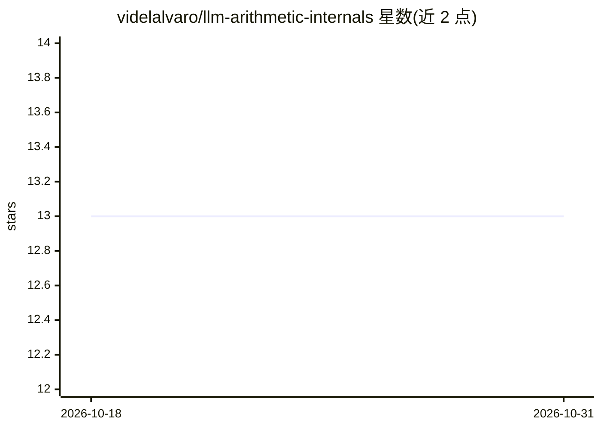

# videlalvaro/llm-arithmetic-internals

⭐ 13 · Python · 推送 2026-06-29 · [GitHub](https://github.com/videlalvaro/llm-arithmetic-internals) · [官网](http://alvaro-videla.com/llm-arithmetic-internals/) · 个人维护

**研究项目：从 LLM 激活中读出算术运算与操作数并路由到计算器**

面向机制可解释性研究的实验项目：在冻结的 Llama-3.1-8B 上，从残差流激活中解码算术运算标签与操作数元组，仅在解码成功后将提示路由到 Python 计算器，路由时不使用正则解析提示文本。覆盖乘法、余除、GCD、LCM 任务的锁定样例评估、对抗与难负例审计、来源重放审计，以及傅里叶相位结构（螺旋分辨率）实验。提供本地交互式文章、PDF 与可复现脚本。明确声明：不修复模型原生算术，Qwen 路由未迁移成功，GCD/LCM 因果检验统计功效不足。

## 筛选速览

| 维度 | 判定 | 备注 |
|---|---|---|
| AI 角色 | `ai-native` | 本体是模型或模型工具 |
| 许可风险 | `none` | — |
| 部署形态 | `library` | 以包/库形式分发 |
| 模型依赖 | — | README 未给出锁定关系 |
| 硬件要求 | — | 无带数字的原话,不猜 |
| 安装摩擦 | `low` | 无编译、无系统依赖或容器化 |
| 成熟度 | `idea` | |

## 能力要点

- 激活导出的 (op, a, b) 元组驱动计算器路由，路由时不解析提示文本
- 三种子、11,736 锁定样例的跨种子评估与零误触发难负例审计
- 15,558 个重放包的来源审计，检查无禁止运行时字段泄漏
- 多位数减法的傅里叶相位/螺旋分辨率实验（6-14 位精度下降曲线）

## 适用场景

- 复现激活导出算术路由的评估与审计结果
- 研究语言模型内部算术表示的相位几何结构
- 阅读交互式文章了解机制可解释性实验方法

## 场景标签

`科研工具` · 领域:学习与行业

## 证据(README 行号)

> L5: Rune is a mechanism-aware JIT compilation project for language-model
> L84: The strongest supported result is the Goal B3 activation-derived route. In
> L90: opaque prompt token IDs + captured activations

## 星数曲线

2026-10-18 13 → 2026-10-31 13（+0）

---
*卡片 v1 · prompt 1.4 · 生成 2026-10-31 · 置信度 low · 依据 README sha `8239db8e6299` · [字段定义](../../DATASET.md)*
