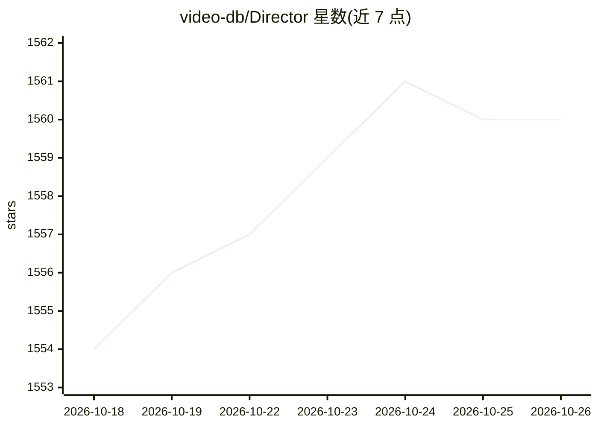

# video-db/Director

⭐ 1,560 · Python · MIT · 推送 2026-01-23 · [GitHub](https://github.com/video-db/Director) · [官网](https://chat.videodb.io) · 组织维护

**构建视频智能体的框架：用自然语言编排搜索、剪辑、生成等视频任务**

VideoDB 团队开源的视频智能体构建框架，基于其 Video-as-Data 基础设施。核心是 Reasoning Engine：解析用户自然语言指令，动态编排多个智能体完成视频摘要、时刻搜索、剪辑、配音、字幕翻译、脚本生成影片等任务，结果通过聊天式 UI（含视频播放器）流式呈现。内置 20+ 可定制智能体，支持复制 sample_agent.py 模板自定义并注册。需 Python 3.9+/Node.js 22.8+，通过 setup.sh 与 make run 本地运行，支持 Mac/Linux/Windows(WSL)，也可一键部署到 Render/Railway。

## 筛选速览

| 维度 | 判定 | 备注 |
|---|---|---|
| AI 角色 | `ai-ecosystem` | LLM/agent 周边工具 |
| 许可风险 | `permissive` | MIT |
| 部署形态 | `None` |  |
| 模型依赖 | — | README 未给出锁定关系 |
| 硬件要求 | — | 无带数字的原话,不猜 |
| 安装摩擦 | `medium` | 含编译或系统依赖之一 |
| 成熟度 | — | 结构信号不足 |

## 能力要点

- Reasoning Engine 按指令动态编排多智能体完成视频任务
- 20+ 预置智能体：摘要、搜索、剪辑、配音、翻译字幕、脚本生成影片
- 提供模板与注册流程（sample_agent.py + handler.py）自定义新智能体
- 聊天式 UI 含视频播放器与媒体库 Collection 视图

## 适用场景

- 用一句自然语言让多个智能体完成上传、剪辑、分发等视频工作流
- 为媒体团队搭建可对话的视频搜索、索引与剪辑工具
- 接入自有 GenAI API 构建定制化视频处理智能体

## 场景标签

`Agent 框架` `多智能体` `图像视频处理` · 领域:Agent 开发

## 证据(README 行号)

> L15:  Framework to build video agents that can reason through complex video tasks like search, editing, compilation, gen
> L29: Think of Director as ChatGPT for videos. It is a framework to build video agents that can reason through complex vi

## 星数曲线

2026-10-18 1,554 → 2026-10-26 1,560（+6）

---
*卡片 v1 · prompt 1.4 · 生成 2026-10-21 · 置信度 high · 依据 README sha `f141f1064664` · [字段定义](../../DATASET.md)*
