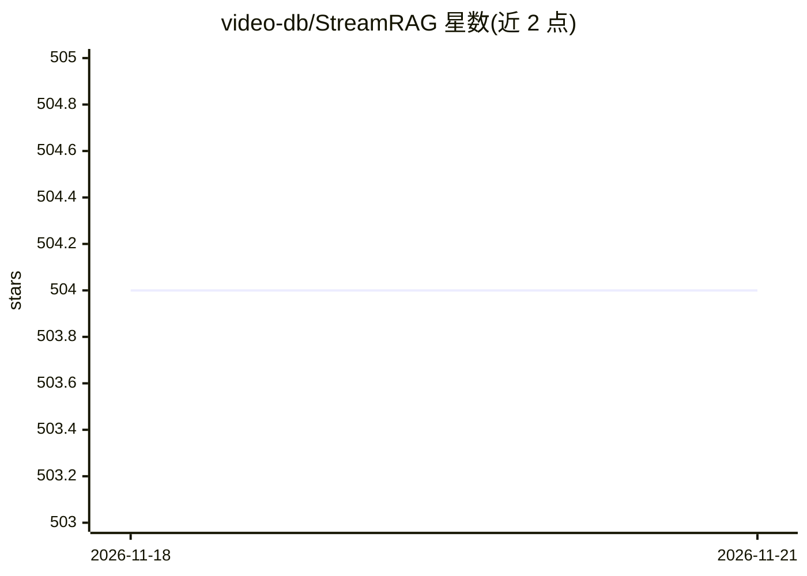

# video-db/StreamRAG

⭐ 504 · Python · MIT · 推送 2026-11-18 · [GitHub](https://github.com/video-db/StreamRAG) · 组织维护

**面向 ChatGPT 的视频检索与流式搜索 Agent 应用**

基于 VideoDB API 的视频检索代理：开发者上传多个视频建立集合，跨视频搜索并获取实时视频片段或剪辑 compilation，以 RAG 形式返回文本摘要答案，并支持将可搜索集合发布到 ChatGPT Store 作为 GPT Action。使用流程为：注册 VideoDB 控制台获取 API key、写入 env 文件、pip 安装依赖、在 upload.py 中添加链接上传集合、python app.py 启动 Flask 服务器；按 openapi.yaml 配置后可发布为自定义 GPT。功能依赖 VideoDB 云服务（前 50 次上传免费）。

## 筛选速览

| 维度 | 判定 | 备注 |
|---|---|---|
| AI 角色 | `ai-native` | 本体是模型或模型工具 |
| 许可风险 | `permissive` | MIT |
| 部署形态 | `library` | 以包/库形式分发 |
| 模型依赖 | — | README 未给出锁定关系 |
| 硬件要求 | — | 无带数字的原话,不猜 |
| 安装摩擦 | `low` | 无编译、无系统依赖或容器化 |
| 成熟度 | — | 结构信号不足 |

## 能力要点

- 上传多个视频建立可搜索集合
- 跨视频搜索返回实时视频片段或剪辑
- RAG 形式的文本摘要答案与视频要点提取
- 支持发布到 ChatGPT Store 作为 GPT Action

## 适用场景

- 为视频集合搭建可搜索的知识库
- 在 ChatGPT 中检索视频并获得摘要回答
- 从特定视频中提取关键要点

## 场景标签

`RAG` `语义搜索` · 领域:知识与检索

## 证据(README 行号)

> L21: # StreamRAG: GPT-Powered Video Retrieval & Streaming 🚀
> L27: It enables developers to:
> L31: * 📝 Receive summarized text answers (RAG).

## 星数曲线

2026-11-18 504 → 2026-11-21 504（+0）

---
*卡片 v1 · prompt 1.4 · 生成 2026-11-18 · 置信度 mid · 依据 README sha `f5e3feee7202` · [字段定义](../../DATASET.md)*
