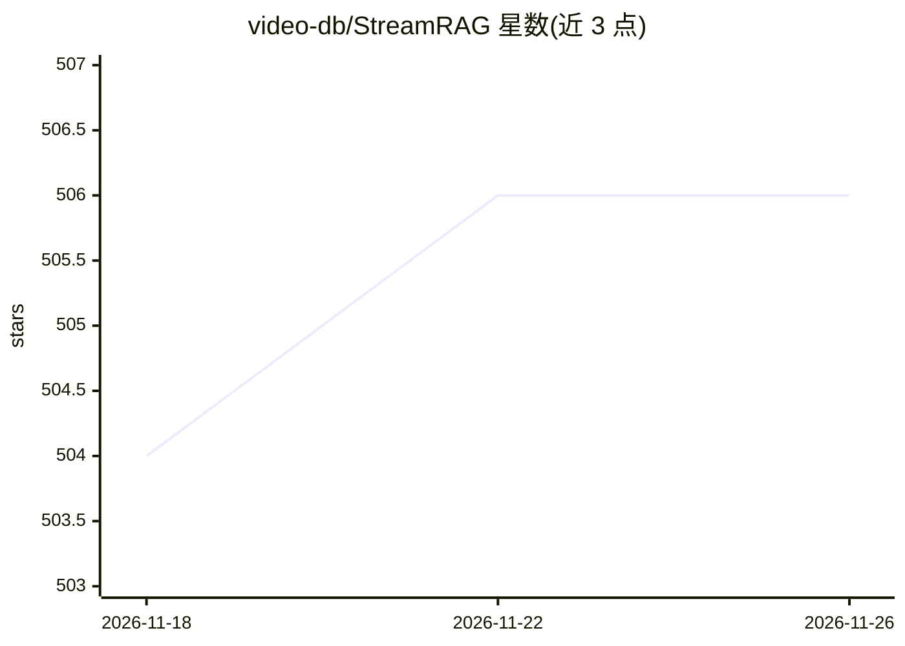

# video-db/StreamRAG

⭐ 506 · Python · MIT · 推送 2026-11-18 · [GitHub](https://github.com/video-db/StreamRAG) · 组织维护

**让开发者在 ChatGPT/Claude 中搜索并播放视频收藏集**

VideoDB 提供的视频搜索与流式 Agent 参考实现：上传视频建立收藏集后，通过 ChatGPT GPT Action（openapi.yaml + Flask 服务）或远程 MCP 服务器（mcp.videodb.io）在 ChatGPT/Claude/Cursor 中执行跨视频搜索、返回摘要答案并播放对应片段，也可发布到 ChatGPT Store。依赖 VideoDB 账户 API key（免费额度 $20），本仓库现为构建自有应用的参考代码。

## 筛选速览

| 维度 | 判定 | 备注 |
|---|---|---|
| AI 角色 | `ai-native` | 本体是模型或模型工具 |
| 许可风险 | `permissive` | MIT |
| 部署形态 | `library` | 以包/库形式分发 |
| 模型依赖 | locked-api |  |
| 硬件要求 | — | 无带数字的原话,不猜 |
| 安装摩擦 | `low` | 无编译、无系统依赖或容器化 |
| 成熟度 | — | 结构信号不足 |

## 能力要点

- 支持经 ChatGPT Action 与远程 MCP 两种方式接入对话工具
- 跨视频搜索返回实时视频片段或合集
- 输出摘要式文本回答（RAG）与视频要点洞察
- 可发布可搜索收藏集到 ChatGPT Store

## 适用场景

- 在 ChatGPT 里搜索自己的视频库并播放相关片段
- 从长视频中提取要点摘要
- 把视频收藏集作为可搜索应用发布到 ChatGPT Store
- 在 Cursor/Claude Code 等 MCP 客户端中接入视频检索

## 场景标签

`RAG` `语义搜索` `聊天机器人` · 领域:对话与助手

## 证据(README 行号)

> L24: Now you can search your video collection in ChatGPT and Claude without building a custom GPT. The collection you up
> L47: * 🔍 Search across these videos and get real-time video responses or compilations.
> L49: * 📝 Receive summarized text answers (RAG).

## 星数曲线

2026-11-18 504 → 2026-11-26 506（+2）

---
*卡片 v1 · prompt 1.4 · 生成 2026-11-25 · 置信度 mid · 依据 README sha `cff7b2ecc164` · [字段定义](../../DATASET.md)*
