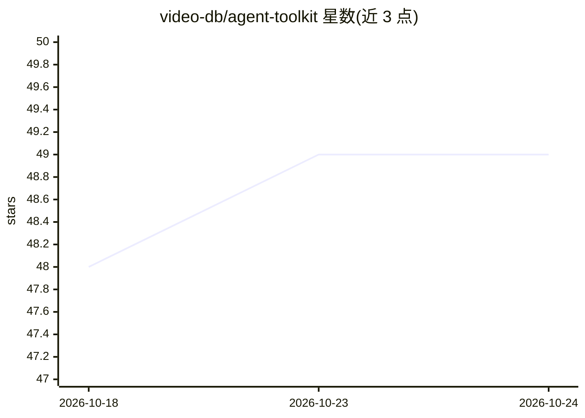

# video-db/agent-toolkit

⭐ 49 · Python · 推送 2026-03-26 · [GitHub](https://github.com/video-db/agent-toolkit) · [官网](https://docs.videodb.io) · 组织维护

**为 LLM/Agent 提供 VideoDB 上下文的工具包（llms.txt + MCP）**

VideoDB 官方的 Agent 工具包，将 VideoDB 的 SDK 结构、文档摘要与示例打包为 LLM 上下文文件（llms.txt 轻量元数据、llms-full.txt 完整上下文）与 MCP Server，供 Cursor、Claude Code 等 AI IDE 与对话 Agent 接入。上下文由 GitHub Actions 自动生成与更新（Sphinx 生成 SDK 文档、FireCrawl 抓取并 LLM 摘要、Notebook 转示例），通过 config.yaml 集中配置包含/排除模式与自定义摘要 prompt。MCP Server 经 uvx 运行，需提供 VIDEODB API key。

## 筛选速览

| 维度 | 判定 | 备注 |
|---|---|---|
| AI 角色 | `ai-ecosystem` | LLM/agent 周边工具 |
| 许可风险 | `none` | — |
| 部署形态 | `None` |  |
| 模型依赖 | — | README 未给出锁定关系 |
| 硬件要求 | — | 无带数字的原话,不猜 |
| 安装摩擦 | `low` | 无编译、无系统依赖或容器化 |
| 成熟度 | — | 结构信号不足 |

## 能力要点

- llms.txt / llms-full.txt 两级 LLM 上下文文件
- MCP Server 经 uvx 运行（videodb-director-mcp）
- GitHub Actions 自动同步 SDK 版本、文档与示例
- config.yaml 支持包含/排除模式与自定义 LLM 摘要 prompt

## 适用场景

- 在 Cursor/Claude Code 等 AI IDE 中接入 VideoDB 能力
- 为基于 VideoDB 的 Agent 提供最新 SDK 上下文
- 按 llms.txt 规范暴露产品元数据供 LLM 发现

## 场景标签

 · 领域:LLM 基础设施/上下文工程

## 证据(README 行号)

> L20: The VideoDB Agent Toolkit exposes VideoDB context to LLMs and agents. It enables integration to AI-driven IDEs like
> L60: The VideoDB MCP Server connects with the Director backend framework, providing a single tool for many workflows. Fo

## 星数曲线

2026-10-18 48 → 2026-10-24 49（+1）

---
*卡片 v1 · prompt 1.4 · 生成 2026-10-24 · 置信度 high · 依据 README sha `c2202b36508d` · [字段定义](../../DATASET.md)*
