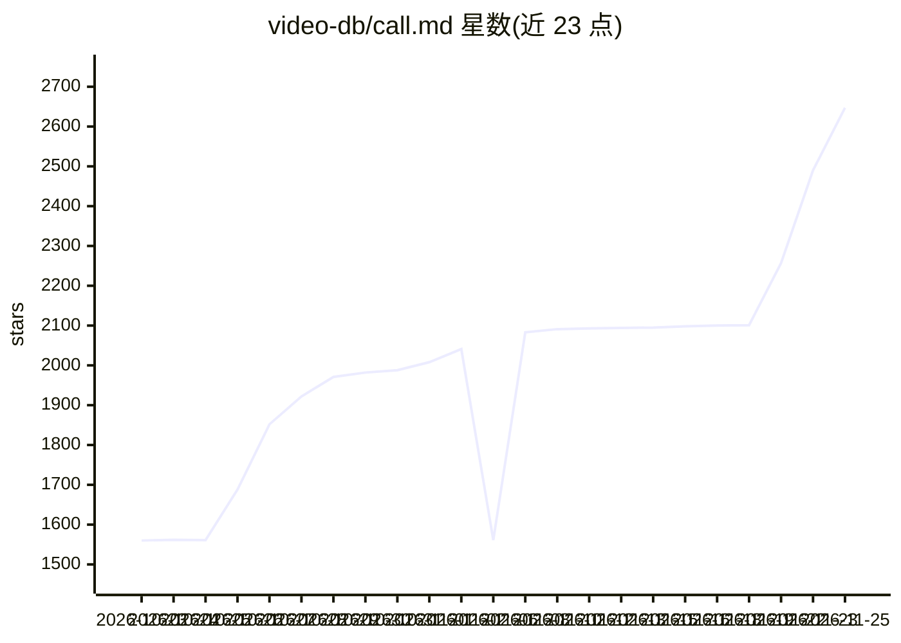

# video-db/call.md

⭐ 2,647 · TypeScript · 推送 2026-11-18 · [GitHub](https://github.com/video-db/call.md) · [官网](https://docs.videodb.io/examples-and-tutorials/ai-copilots/call-md) · 组织维护

**会议录制转写与实时 AI 分析的桌面应用，产出摘要与行动项**

基于 Electron 的会议记录应用：本地录制屏幕与双通道音频（麦克风 vs 系统声音），经 VideoDB WebSocket 实时转写；会中提供 AI 建议话术、对话指标（语速、发言占比）与 MCP 工具自动触发；会后生成三部分摘要（概览、要点、行动项）、导出 Markdown 并经 webhook 推送 n8n/Zapier。录制限 2 小时；数据存本地 SQLite，转写与 AI 功能需联网和 VideoDB API key；录制仅支持 macOS 与 Windows x64。

## 筛选速览

| 维度 | 判定 | 备注 |
|---|---|---|
| AI 角色 | `ai-native` | 本体是模型或模型工具 |
| 许可风险 | `none` | — |
| 部署形态 | `library` | 以包/库形式分发 |
| 模型依赖 | — | README 未给出锁定关系 |
| 硬件要求 | — | 无带数字的原话,不猜 |
| 安装摩擦 | `low` | 无编译、无系统依赖或容器化 |
| 成熟度 | — | 结构信号不足 |

## 能力要点

- 双通道实时转写区分与会者与对方（VideoDB 通道）
- 会中 Live Assist 建议与对话指标（WPM、发言占比、独白检测）
- MCP agent 自动检测信息需求并触发工具，结果内嵌显示
- 会后三部分 AI 摘要与 Markdown 全文导出

## 适用场景

- 销售或客户会议中获取实时应答建议与对话指标
- 会后自动生成带行动项的会议纪要并导出
- 将会议数据接入 n8n/Zapier 工作流自动化
- 在 Claude/ChatGPT 中检索与剪辑过往会议记录

## 场景标签

`知识库管理` `语音识别` · 领域:知识与检索

## 证据(README 行号)

> L14:  Turn meetings into live agent loops. Record, transcribe, and analyze meetings with real-time AI intelligence — bef
> L82: Call.md turns meetings into live agent loops. It records locally, transcribes in real-time (you vs them), and provi
> L89: - **Live Assist** - AI generates contextual suggestions: things to say, questions to ask

## 星数曲线

2026-10-23 1,560 → 2026-11-25 2,647（+1,087）

---
*卡片 v1 · prompt 1.4 · 生成 2026-11-23 · 置信度 high · 依据 README sha `6884ec69dc65` · [字段定义](../../DATASET.md)*
