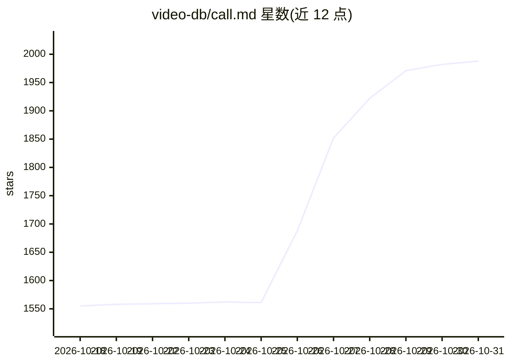

# video-db/call.md

⭐ 1,988 · TypeScript · 推送 2026-10-29 · [GitHub](https://github.com/video-db/call.md) · [官网](https://docs.videodb.io/examples-and-tutorials/ai-copilots/call-md) · 组织维护

**会议录制与实时转录的桌面应用，会后生成 AI 摘要**

基于 Electron/React 的会议助手桌面应用：本地录制屏幕、麦克风与系统音频，双通道音频经 WebSocket 送 VideoDB 实时转录（区分本方/对方），会中提供 AI 建议、对话指标、教练提示，并可自动触发 MCP 工具在面板内展示结果；会后生成三段式摘要（概述/要点/行动项），可经 webhook 发送 n8n、Zapier 或 CRM，并导出 Markdown。需 VideoDB API key 与联网，录制仅支持 macOS arm64/x64 与 Windows x64，单次录制上限 2 小时；数据本地存 SQLite。面向最终用户的消费级应用。

## 筛选速览

| 维度 | 判定 | 备注 |
|---|---|---|
| AI 角色 | `ai-native` | 本体是模型或模型工具 |
| 许可风险 | `none` | — |
| 部署形态 | `library` | 以包/库形式分发 |
| 模型依赖 | — | README 未给出锁定关系 |
| 硬件要求 | — | 无带数字的原话,不猜 |
| 安装摩擦 | `low` | 无编译、无系统依赖或容器化 |
| 成熟度 | — | 结构信号不足 |

## 能力要点

- 双通道实时转录（麦克风 vs 系统音频），支持指定会议语言或自动检测
- 会中 MCP agent 自动检测信息需求并调用工具，结果内联展示
- 会后三段式 AI 摘要（概述/按主题要点/行动项）与 Markdown 导出
- 本地优先：设置、历史、转录与元数据存于本地 SQLite

## 适用场景

- 录制线上会议并获取实时转录与 AI 摘要、行动项
- 会中让 MCP 工具自动查询信息并内联查看结果
- 会议结束后自动把纪要推送到 n8n/Zapier/CRM 工作流

## 场景标签

`语音识别` `AI 写作` · 领域:内容生成

## 证据(README 行号)

> L16:  Turn meetings into live agent loops. Record, transcribe, and analyze meetings with real-time AI intelligence — bef
> L72: - **Dual-Channel Transcription** - Separate transcription for you (mic) vs them (system audio), powered by VideoDB
> L110: - Generates three-part summary: narrative overview, key points, and action items

## 星数曲线

2026-10-18 1,555 → 2026-10-31 1,988（+433）

---
*卡片 v1 · prompt 1.4 · 生成 2026-10-21 · 置信度 mid · 依据 README sha `b4d88349ff11` · [字段定义](../../DATASET.md)*
