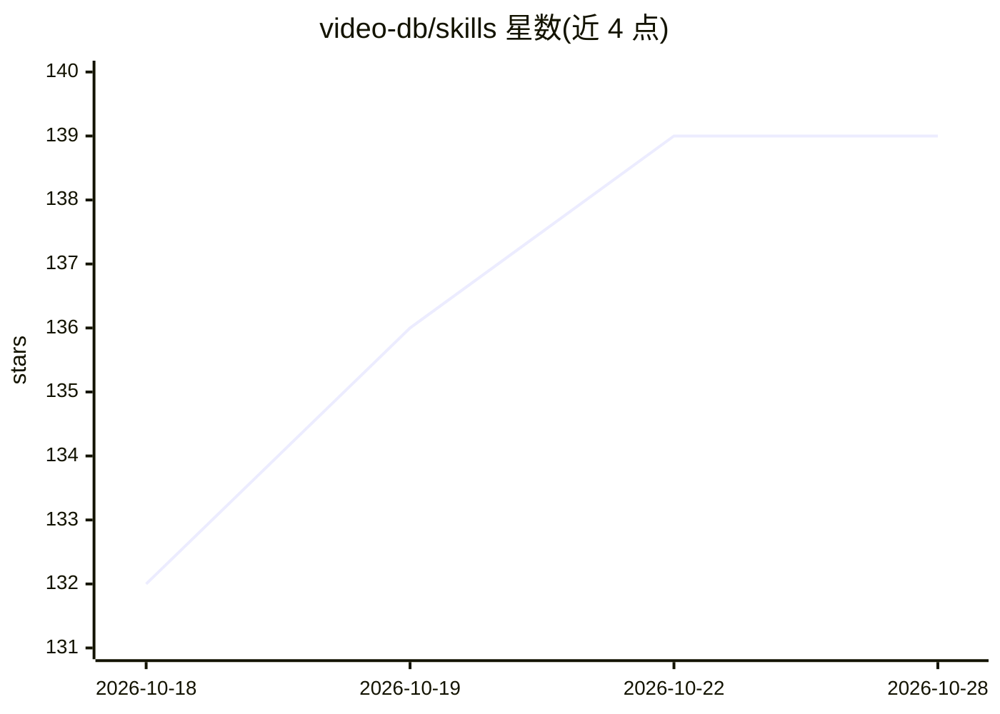

# video-db/skills

⭐ 139 · Python · MIT · 推送 2026-10-28 · [GitHub](https://github.com/video-db/skills) · [官网](https://docs.videodb.io) · 组织维护

**让 AI 编码代理执行服务端视频工作流的技能包**

VideoDB 团队维护的 agent 技能包，为 Claude Code、Cursor、Copilot 等 AI 编码代理提供统一接口：采集桌面屏幕、麦克风、系统音频与 RTSP 流，摄取 YouTube/URL/本地文件；运行语音、场景、物体、OCR、品牌分析并索引结果；支持自然语言搜索视频时刻、生成字幕与转录、剪辑导出、文本生成图像/视频/音乐，并返回可播放的 HLS 链接。通过 npx skills add 或 Claude Code 插件安装，需 Python 3.9+ 与 VideoDB Python SDK，或使用托管 MCP 服务器配合 VideoDB 账号与 API key（依赖 VideoDB 云服务）。

## 筛选速览

| 维度 | 判定 | 备注 |
|---|---|---|
| AI 角色 | `ai-ecosystem` | LLM/agent 周边工具 |
| 许可风险 | `permissive` | MIT |
| 部署形态 | `library` | 以包/库形式分发 |
| 模型依赖 | — | README 未给出锁定关系 |
| 硬件要求 | — | 无带数字的原话,不猜 |
| 安装摩擦 | `medium` | 含编译或系统依赖之一 |
| 成熟度 | — | 结构信号不足 |

## 能力要点

- 采集桌面屏幕/麦克风/系统音频与 RTSP 流，摄取 YouTube/URL/本地文件
- 运行语音、场景、物体、OCR、品牌等分析器并索引，支持自然语言搜索时刻
- 服务端剪辑、字幕、配音翻译与文本生成图像/视频/音乐，返回 HLS 播放链接
- 提供 Claude Code 插件（含托管 MCP 服务器）与 npx skills 两种安装方式

## 适用场景

- 让编码代理上传视频并生成可分享的播放链接或剪辑
- 通过对话在视频中查找特定场景/台词并导出片段
- 用代理监控 RTSP 摄像头画面并在检测到目标时记录告警

## 场景标签

`图像视频处理` `多模态` · 领域:感知与多模态

## 证据(README 行号)

> L10: Works with **Claude Code**, **Cursor**, **Copilot**, and other AI agents
> L16: This skill gives your agent one consistent interface to:
> L103: VideoDB is the server side video stack for agents and apps.

## 星数曲线

2026-10-18 132 → 2026-10-28 139（+7）

---
*卡片 v1 · prompt 1.4 · 生成 2026-10-22 · 置信度 high · 依据 README sha `5b5c2d423e19` · [字段定义](../../DATASET.md)*
