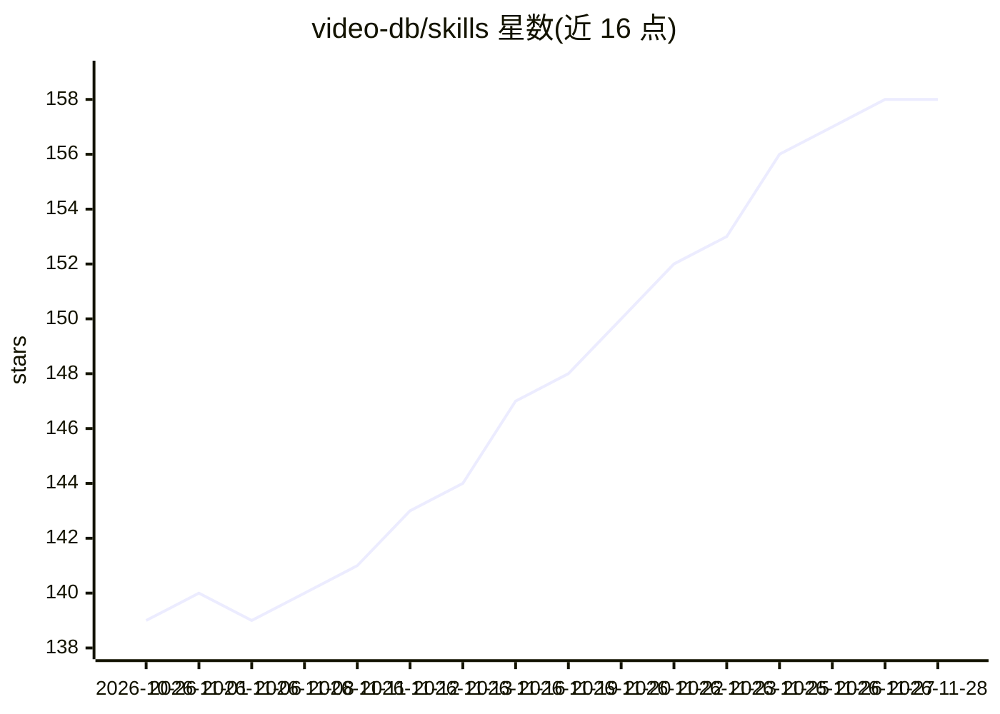

# video-db/skills

⭐ 158 · MIT · 推送 2026-11-27 · [GitHub](https://github.com/video-db/skills) · [官网](https://docs.videodb.io) · 组织维护

**让 AI agent 通过自然语言处理视频的技能与 MCP 集成包**

VideoDB 官方发布的 agent 技能包与 MCP 服务器：提供 6 个 SKILL.md 技能（video-search、video-clips、video-subtitles、video-edit、video-live、videodb），教授 agent 使用 VideoDB Python SDK；并托管一个提供 89 个工具的 MCP 端点。视频的上传、转写、搜索、剪辑、字幕、直播等处理全部在 VideoDB 服务器端完成，结果以 CDN 流链接或下载形式返回。支持一键接入 Claude/ChatGPT 插件，或通过 npx 安装到任意读取 SKILL.md 的编码 agent。需 VideoDB 账号与 API key。

## 筛选速览

| 维度 | 判定 | 备注 |
|---|---|---|
| AI 角色 | `ai-ecosystem` | LLM/agent 周边工具 |
| 许可风险 | `permissive` | MIT |
| 部署形态 | `library` | 以包/库形式分发 |
| 模型依赖 | — | README 未给出锁定关系 |
| 硬件要求 | — | 无带数字的原话,不猜 |
| 安装摩擦 | `low` | 无编译、无系统依赖或容器化 |
| 成熟度 | — | 结构信号不足 |

## 能力要点

- 6 个技能覆盖搜索、剪辑、字幕、编辑、直播等视频工作流
- 托管 MCP 服务器提供 89 个工具（Streamable HTTP + OAuth）
- npx skills add 安装到 Claude Code、Cursor、Codex、Copilot 等编码 agent
- 处理在服务器端进行，本地仅需 Python 3.9+ 的 SDK

## 适用场景

- 粘贴 YouTube 链接让 agent 剪辑、加字幕、翻译
- 对视频提问并返回带时间戳的片段
- 接入摄像头直播流并在检测到人时触发 webhook
- 录制会议并生成可分享的剪辑

## 场景标签

`图像视频处理` · 领域:感知与多模态

## 证据(README 行号)

> L12: VideoDB does the video work on its servers. The agent asks for it in plain language.
> L23: |**A coding agent with a shell** (Claude Code, Cursor, Codex, Copilot, others)|`npx skills add video-db/skills`|The

## 星数曲线

2026-10-26 139 → 2026-11-28 158（+19）

---
*卡片 v1 · prompt 1.4 · 生成 2026-11-27 · 置信度 high · 依据 README sha `ed71175ee68f` · [字段定义](../../DATASET.md)*
