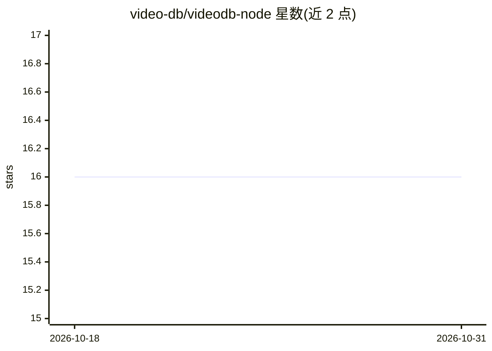

# video-db/videodb-node

⭐ 16 · TypeScript · Apache-2.0 · 推送 2026-09-03 · [GitHub](https://github.com/video-db/videodb-node) · [官网](https://www.npmjs.com/package/videodb) · 组织维护

**VideoDB 云视频数据库的 Node.js SDK：上传索引并语义搜索视频**

VideoDB 官方 Node.js SDK，用于连接其 serverless 视频数据库服务：通过 API key 连接后，可从 YouTube、公开 URL、S3 或本地文件上传视频，生成可播放流与片段剪辑，对视频建立语音转写索引或视觉场景索引，并在单视频或整个集合上执行 semantic/keyword/scene 三种搜索，返回可流式播放的命中片段。还提供 Timeline/Asset API 程序化合成带音频、图片、文字叠加的编译流，以及字幕叠加、缩略图、转写获取等功能。依赖云端服务，前 50 次上传免费；场景索引功能当前仅对 beta 用户开放。

## 筛选速览

| 维度 | 判定 | 备注 |
|---|---|---|
| AI 角色 | `ai-ecosystem` | LLM/agent 周边工具 |
| 许可风险 | `permissive` | Apache-2.0 |
| 部署形态 | `library` | 以包/库形式分发 |
| 模型依赖 | — | README 未给出锁定关系 |
| 硬件要求 | — | 无带数字的原话,不猜 |
| 安装摩擦 | `low` | 无编译、无系统依赖或容器化 |
| 成熟度 | `idea` | |

## 能力要点

- 上传后建立语音/场景索引，支持 semantic、keyword、scene 三种视频内搜索
- 集合级多视频语义搜索（RAG 式），返回可流式播放的命中片段流
- Timeline/Asset API 合成带音频、图片、文字叠加的编译流
- 支持字幕叠加（可自定义样式）、转写获取、缩略图生成

## 适用场景

- 在应用中对视频库做语义搜索并直接流式播放命中片段
- 为播客、课程、新闻等口播视频建立可检索的转写索引
- 程序化剪辑与合成视频片段用于播放或嵌入网站

## 场景标签

`语义搜索` `图像视频处理` · 领域:知识与检索

## 证据(README 行号)

> L22: VideoDB Node.js SDK allows you to interact with the VideoDB serverless database. Manage videos as intelligent data,

## 星数曲线

2026-10-18 16 → 2026-10-31 16（+0）

---
*卡片 v1 · prompt 1.4 · 生成 2026-10-30 · 置信度 high · 依据 README sha `6b275224aa34` · [字段定义](../../DATASET.md)*
