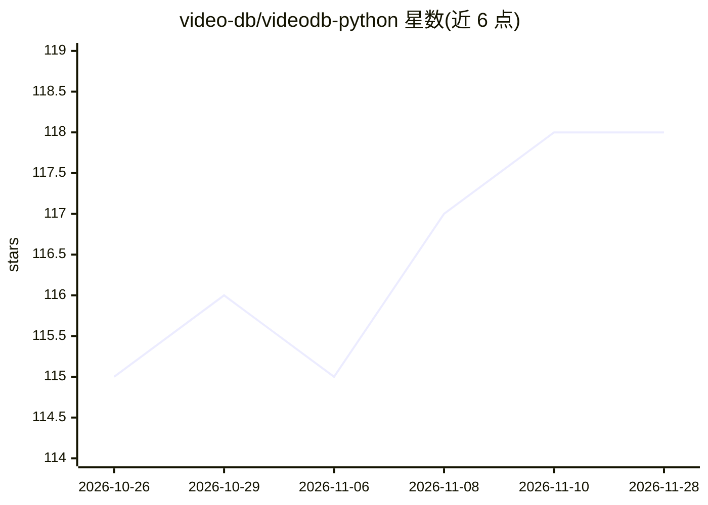

# video-db/videodb-python

⭐ 118 · Python · Apache-2.0 · 推送 2026-11-27 · [GitHub](https://github.com/video-db/videodb-python) · [官网](https://pypi.org/project/videodb) · 组织维护

**给 AI 应用开发者接入 VideoDB 视频基础设施的 Python SDK**

VideoDB Python SDK 通过程序化接口访问 VideoDB 的无服务器视频基础设施，将视频作为结构化数据处理：上传/管理视频、音频与图像，执行语义搜索、场景提取、转录生成与多模态内容生成，检索管线分为 Understand→Index→Retrieve 三阶段。另提供多轨时间线视频编辑、实时流处理、桌面采集、会议录制、配音翻译、转码与 WebSocket 事件。面向开发者，需从 VideoDB Console 获取 API key，新用户赠送 $20 额度。

## 筛选速览

| 维度 | 判定 | 备注 |
|---|---|---|
| AI 角色 | `ai-ecosystem` | LLM/agent 周边工具 |
| 许可风险 | `permissive` | Apache-2.0 |
| 部署形态 | `library` | 以包/库形式分发 |
| 模型依赖 | — | README 未给出锁定关系 |
| 硬件要求 | — | 无带数字的原话,不猜 |
| 安装摩擦 | `low` | 无编译、无系统依赖或容器化 |
| 成熟度 | — | 结构信号不足 |

## 能力要点

- Understand→Index→Retrieve 三段式检索管线，analyzer 产物可复用
- 内置 spoken_words/vlm/OCR/object_detection 等多种 analyzer 类型
- 4 层架构（Assets/Clips/Tracks/Timeline）的程序化多轨视频编辑
- MCP 服务器供 Claude/ChatGPT/Cursor 等 agent 客户端接入

## 适用场景

- 为 AI 应用构建视频语义搜索与问答
- 用代码批量生成转录、字幕与缩略图
- 程序化合成多轨视频并叠加字幕、配乐与特效
- 让 AI agent 通过 MCP 直接观看、搜索并剪辑视频

## 场景标签

`RAG` `语义搜索` `多模态` · 领域:知识与检索

## 证据(README 行号)

> L26: VideoDB Python SDK provides programmatic access to VideoDB's serverless video infrastructure. Build AI applications
> L39: The Python SDK below is for writing code against VideoDB yourself.

## 星数曲线

2026-10-26 115 → 2026-11-28 118（+3）

---
*卡片 v1 · prompt 1.4 · 生成 2026-11-28 · 置信度 high · 依据 README sha `23cdaebe59d8` · [字段定义](../../DATASET.md)*
