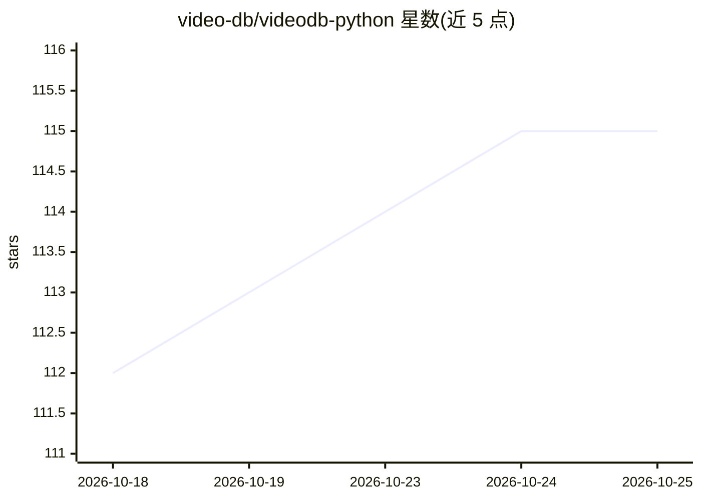

# video-db/videodb-python

⭐ 115 · Python · Apache-2.0 · 推送 2026-10-07 · [GitHub](https://github.com/video-db/videodb-python) · [官网](https://pypi.org/project/videodb) · 组织维护

**VideoDB 云视频基础设施的 Python SDK**

由 VideoDB 团队维护的官方 Python SDK，通过 API key 访问其 serverless 视频基础设施。功能覆盖媒体上传（含 YouTube URL）、Understand→Index→Retrieve 三段式检索管线（转录、VLM、目标检测、OCR 等分析器）、语义搜索、多轨视频编辑、实时流处理、桌面录屏、会议录制、AI 生成图像/音频、视频配音翻译与转码。需 VideoDB 账号与 API key，前 50 次上传免费。

## 筛选速览

| 维度 | 判定 | 备注 |
|---|---|---|
| AI 角色 | `ai-ecosystem` | LLM/agent 周边工具 |
| 许可风险 | `permissive` | Apache-2.0 |
| 部署形态 | `library` | 以包/库形式分发 |
| 模型依赖 | — | README 未给出锁定关系 |
| 硬件要求 | — | 无带数字的原话,不猜 |
| 安装摩擦 | `low` | 无编译、无系统依赖或容器化 |
| 成熟度 | — | 结构信号不足 |

## 能力要点

- Understand→Index→Retrieve 检索管线，分析产物可复用并建多种索引
- 内置分析器：spoken_words、vlm、object_detection、ocr、brand_detection 等
- 多轨时间线视频编辑器（Assets/Clips/Tracks/Timeline 四层架构）
- 生成式媒体、视频配音翻译、会议录制与桌面录屏采集

## 适用场景

- 在 AI 应用中对视频库做语义搜索与场景检索
- 用代码批量生成转录、字幕与视频剪辑
- 录制会议或桌面并实时处理转录事件
- 为视频内容做多语言配音与翻译

## 场景标签

`RAG` `语义搜索` `多模态` `图像视频处理` · 领域:知识与检索

## 证据(README 行号)

> L10:  VideoDB Python SDK
> L24: VideoDB Python SDK provides programmatic access to VideoDB's serverless video infrastructure. Build AI applications

## 星数曲线

2026-10-18 112 → 2026-10-25 115（+3）

---
*卡片 v1 · prompt 1.4 · 生成 2026-10-23 · 置信度 high · 依据 README sha `932271f32a7d` · [字段定义](../../DATASET.md)*
