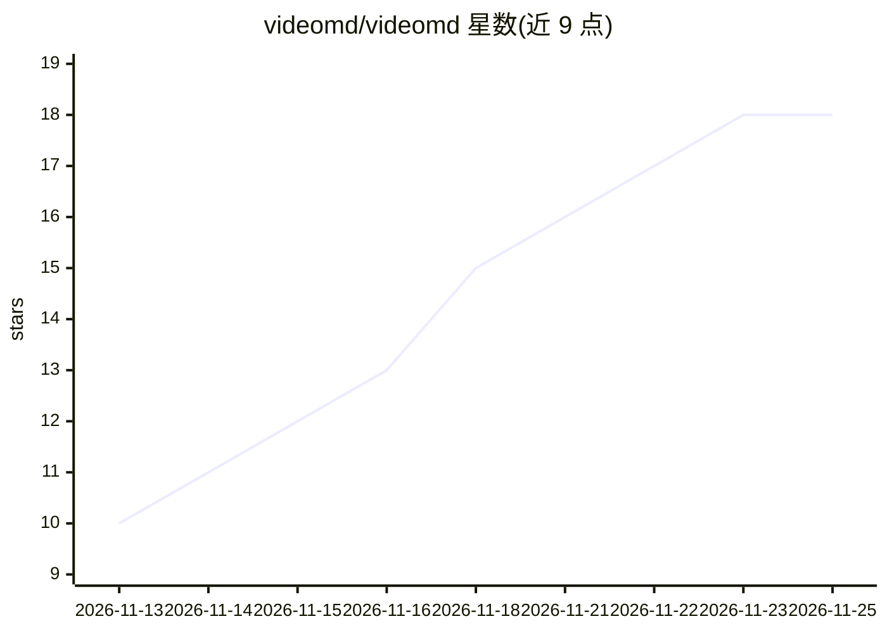

# videomd/videomd

⭐ 18 · Python · Apache-2.0 · 推送 2026-11-12 · [GitHub](https://github.com/videomd/videomd) · [官网](https://videomd.github.io/videomd/) · 组织维护 · 中文 README

**供 AI agent 分层读取视频拆解的开放格式与参考实现**

定义 VIDEO.md 开放格式：把一个视频的拆解（逐镜头内容、制作方式、重制方案）组织为分层包——L0 卡片、L1 概览与地图、L2 时间线与主题、L3 单镜头、L4 原始数据，每层标注 token 数供按需加载；语法上以 ~ 后缀等机制区分'所见'与'推断'，front matter 由 JSON Schema 校验。本仓库提供参考读取器/校验器 videomd（pip 安装，含 CLI），规范文档、示例包与一致性测试包。面向构建 agent/应用与拆解工具的开发者。

## 筛选速览

| 维度 | 判定 | 备注 |
|---|---|---|
| AI 角色 | `ai-ecosystem` | LLM/agent 周边工具 |
| 许可风险 | `permissive` | Apache-2.0 |
| 部署形态 | `library` | 以包/库形式分发 |
| 模型依赖 | — | README 未给出锁定关系 |
| 硬件要求 | — | 无带数字的原话,不猜 |
| 安装摩擦 | `low` | 无编译、无系统依赖或容器化 |
| 成熟度 | — | 结构信号不足 |

## 能力要点

- 分层包结构（L0-L4），卡片约数百 token，概览约 2k token 即可回答多数问题
- token 预算前置：地图列出每个文件的 token 大小
- 所见与推断在语法与数据两层分离，推断项带概率与判定者
- JSON Schema 校验 front matter；未知字段/文件被忽略以支持格式演进

## 适用场景

- 让 agent 在上下文中持有多个视频的卡片、按需展开包内容
- 编写读取/写入 VIDEO.md 包的拆解工具或应用
- 用 CLI 校验自建视频拆解包的规范符合性

## 场景标签

`Agent 框架` `多模态` · 领域:Agent 开发

## 证据(README 行号)

> L3: ### An open format for video breakdowns that models read layer by layer
> L13: A VIDEO.md package describes one video for AI agents and programs: what it shows and says, shot by shot, and, when 
> L73: - **Building an agent or app?** Read docs/integrate.md: discovery, what to put in context, when to load more, hones

## 星数曲线

2026-11-13 10 → 2026-11-25 18（+8）

---
*卡片 v1 · prompt 1.4 · 生成 2026-11-18 · 置信度 high · 依据 README sha `a7941e6ba39e` · [字段定义](../../DATASET.md)*
