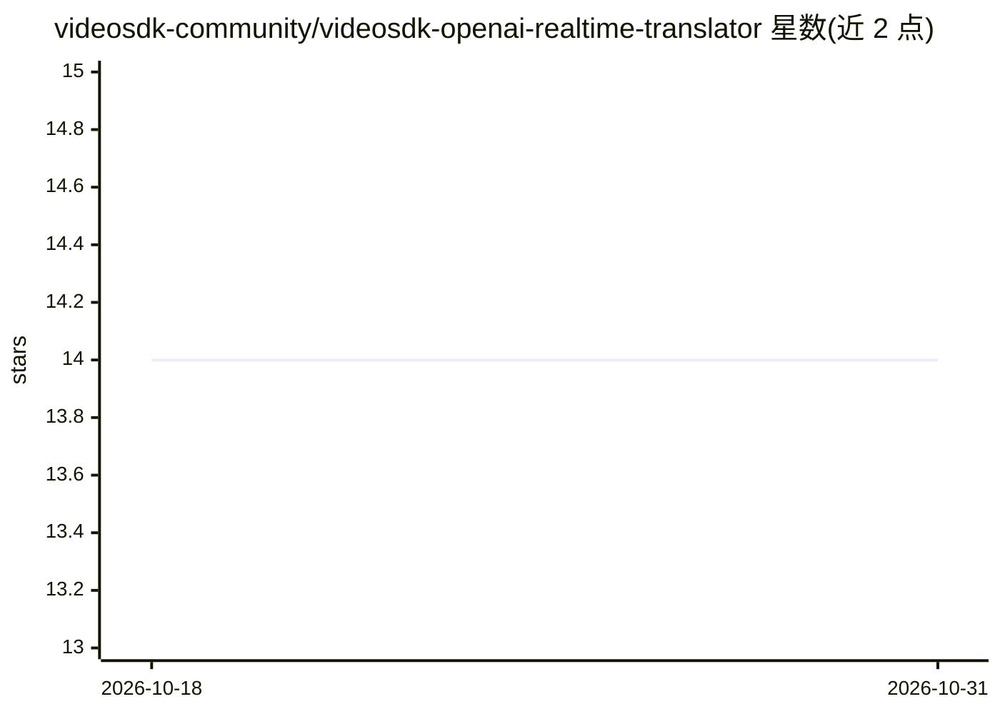

# videosdk-community/videosdk-openai-realtime-translator

⭐ 14 · Python · 推送 2025-12-20 · [GitHub](https://github.com/videosdk-community/videosdk-openai-realtime-translator) · 组织维护

**一对一视频会议的实时语音翻译代理（STT+翻译+TTS）**

由 React 前端会议界面与 Python 后端翻译代理两部分组成：翻译代理以第三名参会者身份加入 VideoSDK 会议，捕获双方音频后经 Google Cloud Speech-to-Text 转文字、Cloud Translation 翻译、Text-to-Speech 合成语音并播放给对方。依赖 VideoSDK 与 Google Cloud 账号及 API key，需 Node.js 与 Python 双端分别启动。限制：仅支持一对一会议，超过 2 人会出现异常行为。

## 筛选速览

| 维度 | 判定 | 备注 |
|---|---|---|
| AI 角色 | `ai-native` | 本体是模型或模型工具 |
| 许可风险 | `none` | — |
| 部署形态 | `library` | 以包/库形式分发 |
| 模型依赖 | — | README 未给出锁定关系 |
| 硬件要求 | — | 无带数字的原话,不猜 |
| 安装摩擦 | `low` | 无编译、无系统依赖或容器化 |
| 成熟度 | — | 结构信号不足 |

## 能力要点

- 翻译代理以参会者身份自动加入 VideoSDK 会议
- Google Cloud STT/翻译/TTS 三段式流水线
- onnxruntime 语音活动检测
- 默认语言可在 main.py 中修改

## 适用场景

- 两名不同语言用户进行实时翻译视频通话
- 调试查看 TTS 生成音频与音频流（tts_audio_files/、audio_debug/）

## 场景标签

 · 领域:视频会议/语音翻译

## 证据(README 行号)

> L3: A real-time video conferencing translation system powered by VideoSDK, Google Cloud Speech-to-Text, Translation, and
> L13: - Capturing audio from meeting participants
> L14: - Converting speech to text (STT)
> L15: - Translating text to the target language
> L16: - Converting translated text back to speech (TTS)

## 星数曲线

2026-10-18 14 → 2026-10-31 14（+0）

---
*卡片 v1 · prompt 1.4 · 生成 2026-10-31 · 置信度 high · 依据 README sha `9e23362a2f05` · [字段定义](../../DATASET.md)*
