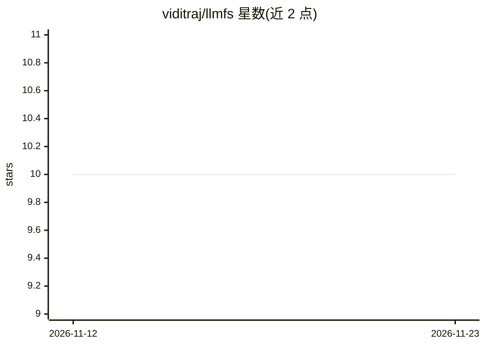

# viditraj/llmfs

⭐ 10 · Python · Apache-2.0 · 推送 2026-09-12 · [GitHub](https://github.com/viditraj/llmfs) · 个人维护

**为 LLM 与 AI Agent 提供文件系统式持久记忆的 Python 库**

以文件系统路径组织 Agent 记忆的本地存储层：用 ChromaDB 与 all-MiniLM-L6-v2 做语义检索，底层为 SQLite 与 Chroma 持久化。记忆分 short_term/session/knowledge/events 四层并支持 TTL 自动回收、标签、元数据与知识图谱关联，提供 MQL 查询语言。交付形态包括 Python API、CLI、内置 MCP 服务器（可一键写入 Claude/Cursor/Windsurf/Continue 配置）与 LangChain 记忆适配器；首次运行下载约 22 MB 嵌入模型，无需 GPU。

## 筛选速览

| 维度 | 判定 | 备注 |
|---|---|---|
| AI 角色 | `ai-ecosystem` | LLM/agent 周边工具 |
| 许可风险 | `permissive` | Apache-2.0 |
| 部署形态 | `library` | 以包/库形式分发 |
| 模型依赖 | — | README 未给出锁定关系 |
| 硬件要求 | `cpu-ok` | |
| 安装摩擦 | `low` | 无编译、无系统依赖或容器化 |
| 成熟度 | — | 结构信号不足 |

## 能力要点

- 四层记忆（short_term/session/knowledge/events）与 TTL 自动垃圾回收
- 文件系统式路径组织 + 语义检索 + MQL 结构化查询
- 内置 MCP 服务器，六个 memory_* 工具接入 MCP 客户端
- 可选 FUSE 文件系统挂载与 LangChain 记忆适配器

## 适用场景

- 给多轮对话 Agent 挂持久记忆，避免截断上下文
- 把项目知识、决策、事件按路径长期存档并语义检索
- 通过 MCP 让桌面 AI 客户端直接读写本地记忆库
- 为 LangChain 对话链提供持久聊天历史与上下文注入

## 场景标签

`Agent 记忆` · 领域:Agent 开发

## 证据(README 行号)

> L8: **LLMFS gives LLMs and AI agents persistent, searchable, structured memory — organized like a filesystem.** Instead 
> L27: Memories are stored at filesystem-style paths (`/projects/auth/bug`, `/events/2026-03-15_fix`) and searched semanti
> L406: LLMFS ships a full Model Context Protocol server that exposes all six core tools to any MCP-compatible client. Onc

## 星数曲线

2026-11-12 10 → 2026-11-23 10（+0）

---
*卡片 v1 · prompt 1.4 · 生成 2026-11-19 · 置信度 high · 依据 README sha `ee0b16ffccb4` · [字段定义](../../DATASET.md)*
