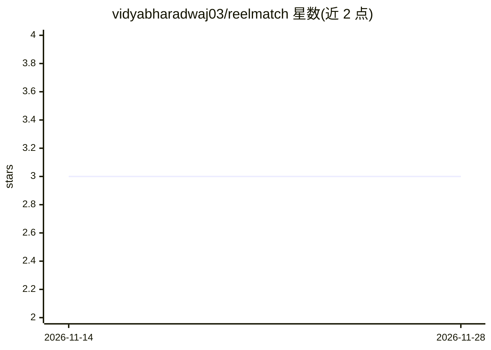

# vidyabharadwaj03/reelmatch

⭐ 3 · Python · MIT · 推送 2026-10-30 · [GitHub](https://github.com/vidyabharadwaj03/reelmatch) · 个人维护

**面向营销者：由 brief 与照片生成 UGC 风格竖版广告草稿**

通过 Comfy Cloud API 调用视频模型的 Web 应用：用户以按钮表单描述广告活动（目标、平台、时长、风格、预算等），上传产品照片后一步生成竖版 UGC 广告草稿。内置模型注册表按规则（时长范围、照片数、声音、真人肖像、积分预算）逐条通过/失败打分，展示每个模型的评分依据并允许手动切换；含脚本生成、浏览器录音配音、音乐闪避混音（ffmpeg）。需 Comfy API key 与积分，支持 MOCK 模式离线跑通全流程，可经 render.yaml 部署并带访问码与积分限额。

## 筛选速览

| 维度 | 判定 | 备注 |
|---|---|---|
| AI 角色 | `ai-native` | 本体是模型或模型工具 |
| 许可风险 | `permissive` | MIT |
| 部署形态 | `library` | 以包/库形式分发 |
| 模型依赖 | — | README 未给出锁定关系 |
| 硬件要求 | — | 无带数字的原话,不猜 |
| 安装摩擦 | `medium` | 含编译或系统依赖之一 |
| 成熟度 | — | 结构信号不足 |

## 能力要点

- 按规则对每个视频模型打分并展示选择依据，支持手动切换
- 内置录音配音与音乐闪避混音（imageio-ffmpeg 打包）
- MOCK 模式无需调用 Comfy 即可跑通全流程
- 带访问码、总积分预算与上传/渲染文件定时删除的部署配置

## 适用场景

- 从活动描述和产品照片快速产出竖版 UGC 广告草稿
- 比较不同视频模型对同一 brief 的适配情况与成本
- 用录制的真人声音作为广告配音并混入背景音乐

## 场景标签

`视频生成` · 领域:内容生成

## 证据(README 行号)

> L3: Describe your campaign with a few taps, drop in photos, and press one button to get a vertical UGC-style ad draft.
> L4: Reelmatch picks the video model for you behind the scenes and renders the draft through Comfy Cloud.
> L47: `app/registry.py` checks every model against the brief and returns a pass or fail per rule: adapter wired up, open 

## 星数曲线

2026-11-14 3 → 2026-11-28 3（+0）

---
*卡片 v1 · prompt 1.4 · 生成 2026-11-26 · 置信度 high · 依据 README sha `fa81fe065bb1` · [字段定义](../../DATASET.md)*
