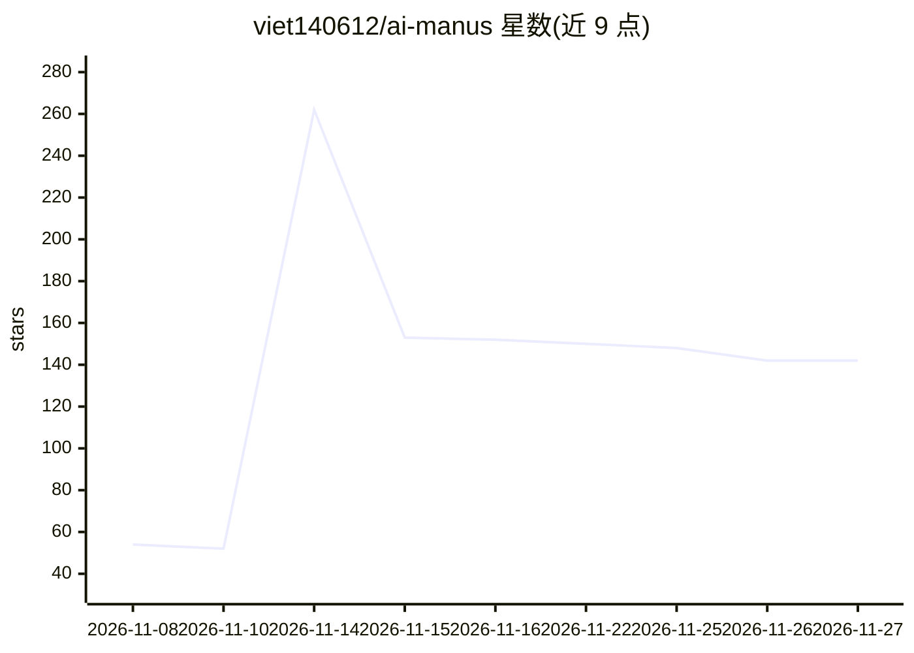

# viet140612/ai-manus

⭐ 142 · Python · Apache-2.0 · 推送 2026-11-08 · [GitHub](https://github.com/viet140612/ai-manus) · 个人维护

**面向个人用户的自主 AI Agent：代跑代码与控制浏览器**

README 以宣传性描述为主：宣称该 Agent 可自主编写并执行脚本、控制浏览器完成页面导航、表单填写与信息收集，支持代码与浏览器动作混合的多步骤任务，定位为家庭、学习与轻量办公场景的后台个人助手，面向无需编程背景的普通用户。给出兼容性表（最低 4GB 内存、双核 CPU）与使用步骤说明，但未提供任何具体安装命令、依赖清单、技术架构或模型接入方式，各能力的实现机制不可从 README 验证。

## 筛选速览

| 维度 | 判定 | 备注 |
|---|---|---|
| AI 角色 | `ai-native` | 本体是模型或模型工具 |
| 许可风险 | `permissive` | Apache-2.0 |
| 部署形态 | `None` |  |
| 模型依赖 | — | README 未给出锁定关系 |
| 硬件要求 | — | 无带数字的原话,不猜 |
| 安装摩擦 | `low` | 无编译、无系统依赖或容器化 |
| 成熟度 | — | 结构信号不足 |

## 能力要点

- 宣称支持自主代码执行与浏览器控制的多步骤任务
- 定位个人助手：学习、家庭项目与轻量办公场景
- 提供兼容性要求表（最低 4GB 内存、双核 CPU）

## 适用场景

- 让 Agent 代为完成重复性的脚本执行与网页操作
- 整理研究资料、跨页面收集信息并生成摘要
- 无编程背景下委托小型日常任务

## 场景标签

`AI 助手` `编码 Agent` `浏览器自动化` · 领域:效率与自动化

## 证据(README 行号)

> L10: - **Autonomous Code Execution:** Manus AI agent runs code on its own to complete tasks, so you can focus on decisio
> L18: Manus is an autonomous AI agent designed to run code and control a browser on your behalf. Instead of acting like a

## 星数曲线

2026-11-08 54 → 2026-11-27 142（+88）

---
*卡片 v1 · prompt 1.4 · 生成 2026-11-17 · 置信度 low · 依据 README sha `790070d90930` · [字段定义](../../DATASET.md)*
