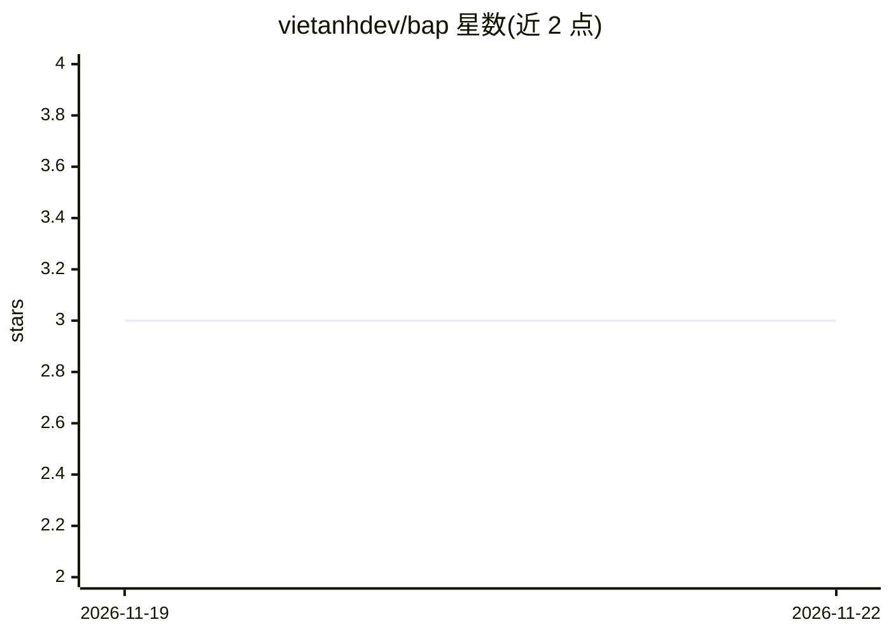

# vietanhdev/bap

⭐ 3 · C · MIT · 推送 2026-11-19 · [GitHub](https://github.com/vietanhdev/bap) · [官网](https://bap.nrl.ai) · 个人维护

**SenseCAP Watcher 上的语音助手固件，直连 Gemini Live 对话**

为 Seeed SenseCAP Watcher（ESP32-S3）编写的开源固件，以 xiaozhi-esp32 为底座、通过一个 patch 接入 Gemini Live API，实现实时双向语音对话（可打断、字幕、口型同步）。设备端绘制 LVGL 角色（5 个角色、23 种表情）、提供 28 个内置工具（农历、天气、新闻、闹钟等）、Zing 音乐与电台播放、四种语言，本地网页配置 API key/模型/角色并通过 Wi-Fi OTA 更新。需要 Watcher 硬件、Linux 构建环境（Docker、uv）与 Gemini API key。

## 筛选速览

| 维度 | 判定 | 备注 |
|---|---|---|
| AI 角色 | `ai-native` | 本体是模型或模型工具 |
| 许可风险 | `permissive` | MIT |
| 部署形态 | `None` |  |
| 模型依赖 | — | README 未给出锁定关系 |
| 硬件要求 | — | 无带数字的原话,不猜 |
| 安装摩擦 | `medium` | 含编译或系统依赖之一 |
| 成熟度 | — | 结构信号不足 |

## 能力要点

- 设备直连 Gemini Live（WebSocket+TLS），无中继服务器
- 5 个 LVGL 原生绘制角色，各 23 种表情并带口型同步
- 28 个设备端工具（农历、天气、新闻、汇率、记忆等），无需额外 API key
- 本地网页设置页、RSA-3072 签名 OTA 更新、可随时还原原厂固件

## 适用场景

- 把 SenseCAP Watcher 变成可对话的桌面语音助手
- 离线/端侧场景下查询农历、天气、新闻、汇率等信息
- 给孩子用角色化语音讲睡前故事、练英语或韩语基础

## 场景标签

`语音 Agent` `AI 助手` · 领域:对话与助手

## 证据(README 行号)

> L3:  A cute, fast voice assistant firmware for the Seeed SenseCAP Watcher
> L48: Real-time two-way audio with Gemini Live: interrupt anytime, live subtitles on the round screen.
> L95: |Voice backend|A vendor or self-hosted server relays audio|**Device ↔ Gemini Live directly** (WebSocket + TLS)|

## 星数曲线

2026-11-19 3 → 2026-11-22 3（+0）

---
*卡片 v1 · prompt 1.4 · 生成 2026-11-21 · 置信度 high · 依据 README sha `8bf06b6edc55` · [字段定义](../../DATASET.md)*
