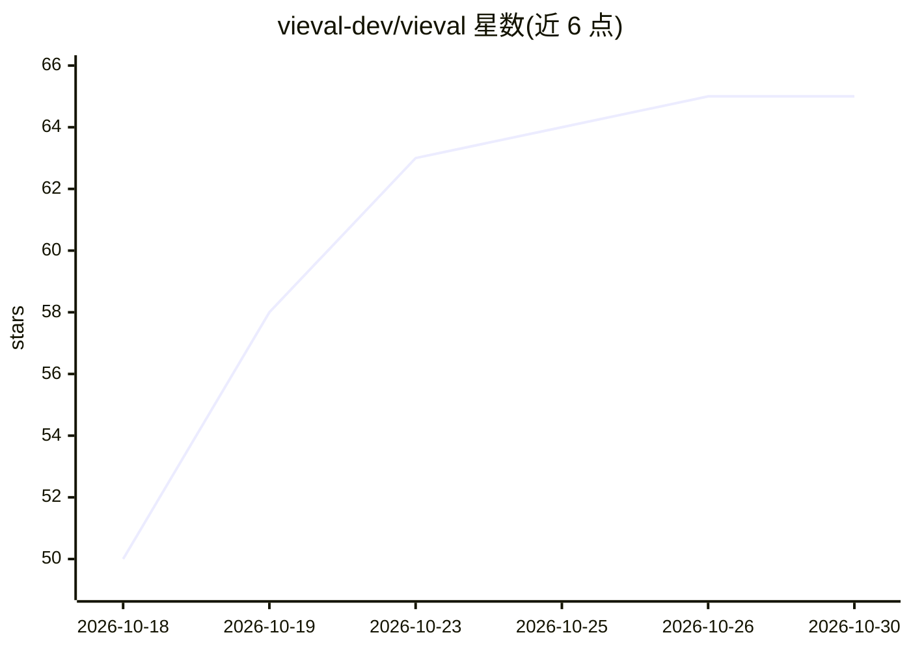

# vieval-dev/vieval

⭐ 65 · TypeScript · MIT · 推送 2026-10-21 · [GitHub](https://github.com/vieval-dev/vieval) · [官网](https://vieval.dev/en/) · 组织维护

**Vitest 风格的 agent/模型评测框架**

面向开发者的评测框架：以 Vitest 类似的 describeTask/caseOf/expect API 编写 eval 文件，支持项目/eval/任务三层矩阵（模型、场景、rubric、数据集变体）、任务自动发现、comparison→workspace→project→task→case 的运行层级，可跨多个 agent/模型实现并行对比并输出排行榜。内置 ChatModels 聊天模型注册与自定义 executor（支持 ASR、TTS、图像等非聊天负载），提供 attempt/retry 可靠性机制、0..1 分数与延迟/成本指标、CLI 终端输出、JSON 与报告产物及 viewer 命令。以 npm 包形式提供。

## 筛选速览

| 维度 | 判定 | 备注 |
|---|---|---|
| AI 角色 | `ai-ecosystem` | LLM/agent 周边工具 |
| 许可风险 | `permissive` | MIT |
| 部署形态 | `library` | 以包/库形式分发 |
| 模型依赖 | — | README 未给出锁定关系 |
| 硬件要求 | — | 无带数字的原话,不猜 |
| 安装摩擦 | `low` | 无编译、无系统依赖或容器化 |
| 成熟度 | — | 结构信号不足 |

## 能力要点

- Vitest 风格 describeTask/caseOf/expect 编写评测
- comparison/workspace/project 三层层级支持多实现并行横向对比与排行榜
- 矩阵模型覆盖模型/场景/rubric/数据集变体
- 自定义 executor 支持 ASR/TTS/图像等非聊天负载

## 适用场景

- 为 LLM 应用与 agent 任务编写可复现的评测
- 横向对比多个模型或 agent 实现并生成排行榜
- 在 CI 中用 CLI 运行评测并产出 JSON/报告

## 场景标签

`模型评测` · 领域:评测与运维

## 证据(README 行号)

> L9: Vitest-style evaluation framework for agents, models, and task pipelines.
> L17: - Built-in chat-model registration through `ChatModels`, plus custom project executors for non-chat workloads.

## 星数曲线

2026-10-18 50 → 2026-10-30 65（+15）

---
*卡片 v1 · prompt 1.4 · 生成 2026-10-24 · 置信度 high · 依据 README sha `f391821047d0` · [字段定义](../../DATASET.md)*
