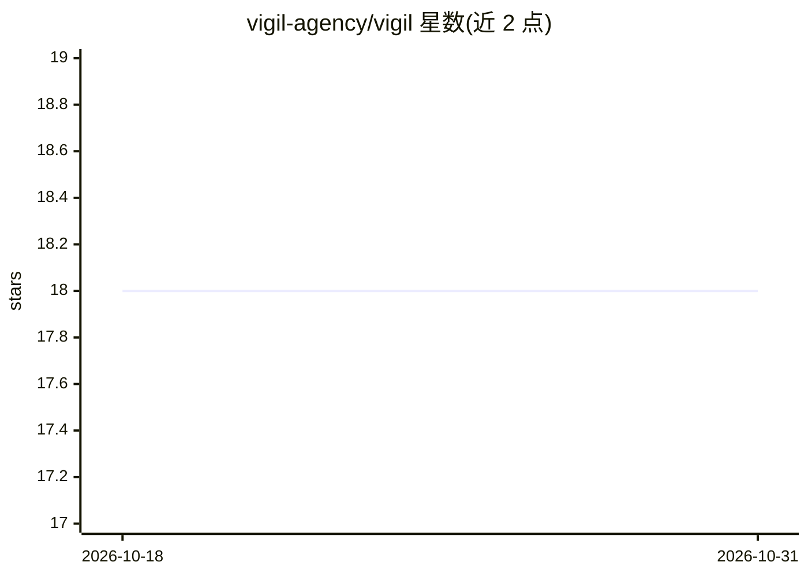

# vigil-agency/vigil

⭐ 18 · JavaScript · AGPL-3.0 · 推送 2026-05-24 · [GitHub](https://github.com/vigil-agency/vigil) · [官网](https://vigil.agency) · 组织维护

**开源 AI 安全运营平台：漏洞扫描、事件响应与合规跟踪**

单进程 Express.js 应用，内置 6 种扫描器（Nmap、Nuclei、Trivy、Nikto、OpenSSL、DNS/WHOIS）覆盖网络、漏洞、容器、Web、证书与 DNS 侦察；提供 20 个自主 agent、事件响应工作流、SOC 2/ISO 27001 等合规跟踪，以及含 25+ 工具的 MCP 服务器供 Claude Desktop/Code/Cursor 接入。AI 采用 BYOK 模式，通过调用本地 Claude/Codex CLI 实现，可禁用并优雅降级；默认 JSON 文件存储，可选 PostgreSQL。支持 npm、Docker Compose 与独立 Docker 部署。

## 筛选速览

| 维度 | 判定 | 备注 |
|---|---|---|
| AI 角色 | `ai-enhanced` | 去掉 AI 部分产品仍成立 |
| 许可风险 | `viral` | AGPL-3.0 |
| 部署形态 | `self-host` | docker 或自建部署 |
| 模型依赖 | — | README 未给出锁定关系 |
| 硬件要求 | — | 无带数字的原话,不猜 |
| 安装摩擦 | `low` | 无编译、无系统依赖或容器化 |
| 成熟度 | — | 结构信号不足 |

## 能力要点

- 6 种内置扫描器（Nmap/Nuclei/Trivy/Nikto/OpenSSL/DNS）
- 20 个自主 agent 与并行 campaign 调度
- 内置 MCP 服务器：25+ 工具、3 资源、4 prompts
- BYOK AI：调用本地 Claude/Codex CLI，可禁用并优雅降级

## 适用场景

- 对自己的资产进行漏洞扫描与安全态势监控
- 团队开展事件响应与合规跟踪（SOC 2/ISO 27001 等）
- 通过 MCP 让 Claude Desktop/Code/Cursor 调用安全扫描工具

## 场景标签

`网络安全` · 领域:学习与行业

## 证据(README 行号)

> L17: Open-source, AI-powered security operations platform. Vulnerability scanning, autonomous agents, incident response,
> L184: - **None** — AI features disabled, graceful degradation

## 星数曲线

2026-10-18 18 → 2026-10-31 18（+0）

---
*卡片 v1 · prompt 1.4 · 生成 2026-10-29 · 置信度 high · 依据 README sha `a630dc5022ea` · [字段定义](../../DATASET.md)*
