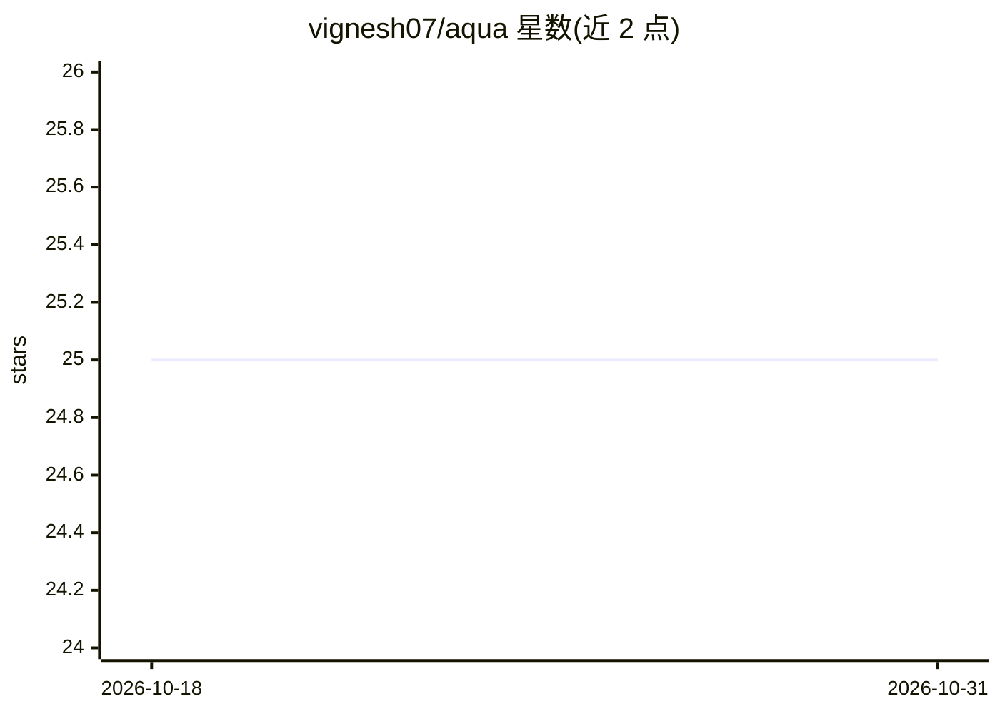

# vignesh07/aqua

⭐ 25 · Python · MIT · 推送 2026-03-22 · [GitHub](https://github.com/vignesh07/aqua) · [官网](https://vignesh07.github.io/aqua/) · 个人维护

**多 CLI AI 代理协作协调器：任务队列/文件锁/消息与监控**

面向在共享代码库中并行工作的多个 CLI AI 代理（Claude Code、Codex CLI、Gemini CLI 或任意 CLI 工具）的轻量协调工具。提供带原子认领的共享任务队列（支持优先级与依赖）、文件锁、代理间消息、实时监控面板、领导选举与心跳崩溃恢复（5 分钟超时后重派任务）。基于 SQLite，无 Redis/Docker 等外部依赖。附带 Observer/Informer 知识持久化系统、代理角色分配、serialize+loop 长项目模式与全命令 JSON 输出。经 pip 安装，需 Python 3.10+。

## 筛选速览

| 维度 | 判定 | 备注 |
|---|---|---|
| AI 角色 | `ai-ecosystem` | LLM/agent 周边工具 |
| 许可风险 | `permissive` | MIT |
| 部署形态 | `library` | 以包/库形式分发 |
| 模型依赖 | — | README 未给出锁定关系 |
| 硬件要求 | — | 无带数字的原话,不猜 |
| 安装摩擦 | `low` | 无编译、无系统依赖或容器化 |
| 成熟度 | — | 结构信号不足 |

## 能力要点

- 共享任务队列（原子认领、优先级、依赖、循环依赖检测）
- 文件锁与代理间消息，防止并发编辑冲突
- 领导选举与心跳崩溃恢复（5 分钟超时自动重派任务）
- 仅依赖 SQLite，零外部服务；全命令支持 --json

## 适用场景

- 让多个 CLI AI 代理在共享代码库上并行分工开发
- 长周期多任务项目用 serialize+loop 轮换新代理避免上下文溢出
- 实时监控多代理工作状态并恢复崩溃的代理

## 场景标签

`编码 Agent` `多智能体` · 领域:Agent 开发

## 证据(README 行号)

> L7: **Aqua** is a lightweight, agent-agnostic coordinator for CLI AI agents. It enables multiple AI agents (Claude Code,
> L18: Aqua solves this by providing:
> L33: - **Agent Agnostic**: Works with Claude Code, Codex CLI, Gemini CLI, or any CLI tool

## 星数曲线

2026-10-18 25 → 2026-10-31 25（+0）

---
*卡片 v1 · prompt 1.4 · 生成 2026-10-26 · 置信度 high · 依据 README sha `aa3f4aa80faf` · [字段定义](../../DATASET.md)*
