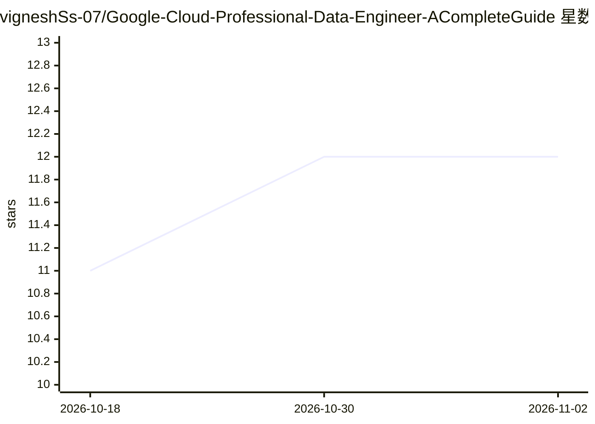

# vigneshSs-07/Google-Cloud-Professional-Data-Engineer-ACompleteGuide

⭐ 12 · Python · 推送 2026-02-11 · [GitHub](https://github.com/vigneshSs-07/Google-Cloud-Professional-Data-Engineer-ACompleteGuide) · [官网](https://www.udemy.com/course/gcp-professional-dataengineer-certification-a-complete-guide/) · 组织维护

**GCP 数据工程师认证课程配套学习与实验资料库**

Udemy 课程《Google Cloud Professional Data Engineer - A Complete Guide》的官方配套仓库，含 39 个章节的学习材料：覆盖 GCP 存储、数据库、BigQuery、Dataflow、Dataproc、Composer、数据治理等服务的讲义、速查表、分步实验（含 solutions/scripts/data 目录结构）、练习题与认证备考模拟测试。面向准备 GCP Professional Data Engineer 认证的数据工程师、云工程师与 DevOps 工程师，需自备 GCP 账号与 gcloud CLI，通过 git clone 获取仓库。

## 筛选速览

| 维度 | 判定 | 备注 |
|---|---|---|
| AI 角色 | `ai-knowledge` | 知识聚合/清单类 |
| 许可风险 | `none` | — |
| 部署形态 | `None` |  |
| 模型依赖 | — | README 未给出锁定关系 |
| 硬件要求 | — | 无带数字的原话,不猜 |
| 安装摩擦 | `low` | 无编译、无系统依赖或容器化 |
| 成熟度 | — | 结构信号不足 |

## 能力要点

- 39 个章节覆盖 GCP 数据工程各服务（存储/BigQuery/Dataflow/Composer 等）
- 每章配套分步实验，含完整解答、脚本与示例数据
- 认证备考内容：练习题、模拟考试与考试域覆盖对照（5 大域占比）
- 提供 5 阶段学习路径清单与实验目录结构约定

## 适用场景

- 按学习路径系统备考 GCP 数据工程师认证
- 跟随各章节实验动手练习 GCP 数据服务
- 用速查表与练习题复习薄弱考试域

## 场景标签

`教程课程` · 领域:学习与行业

## 证据(README 行号)

> L9: This is the official GitHub repository for the **Google Cloud Professional Data Engineer - A Complete Guide** course
> L17: This **39-section comprehensive course** is designed to take you from foundational concepts to mastering Google Clo
> L30: - 🎬 **39 Comprehensive Sections** covering all GCP data engineering services

## 星数曲线

2026-10-18 11 → 2026-11-02 12（+1）

---
*卡片 v1 · prompt 1.4 · 生成 2026-10-31 · 置信度 high · 依据 README sha `e949bf00e1ae` · [字段定义](../../DATASET.md)*
