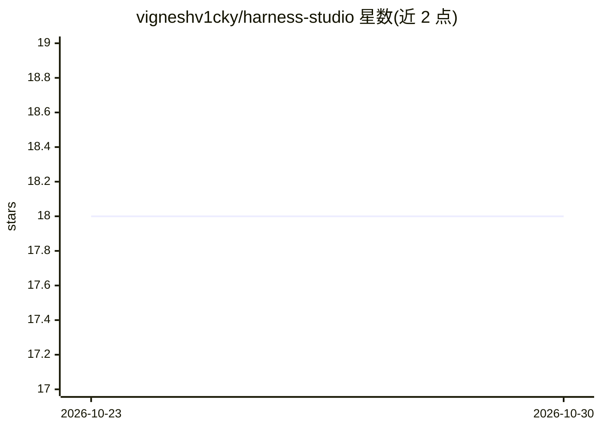

# vigneshv1cky/harness-studio

⭐ 18 · JavaScript · MIT · 推送 2026-10-21 · [GitHub](https://github.com/vigneshv1cky/harness-studio) · [官网](https://github.com/vigneshv1cky/harness-studio/releases/latest) · 个人维护

**macOS/Linux 桌面编码 Agent 应用，任意模型操作代码与 UI**

基于 DeepSeek Harness 构建的桌面编码 Agent 应用，macOS（Apple Silicon）与 Linux 提供安装包。用户接入自有 API key 的任意模型后，Agent 可在项目代码上工作：通过浏览器面板读取开发页面与 DevTools、按元素定位源码行进行 UI 修改、生成 Office 文档与图表、沙箱内构建并运行桌面/移动应用、本地 SenseVoice 语音识别（约 241MB，音频不出本机）、支持 MCP 连接器与 Claude Code 格式的权限规则。处于 Developer preview（0.3.4），Windows 尚未提供；Mac 应用未签名需手动放行。

## 筛选速览

| 维度 | 判定 | 备注 |
|---|---|---|
| AI 角色 | `ai-native` | 本体是模型或模型工具 |
| 许可风险 | `permissive` | MIT |
| 部署形态 | `desktop` | 安装包/桌面程序 |
| 模型依赖 | — | README 未给出锁定关系 |
| 硬件要求 | — | 无带数字的原话,不猜 |
| 安装摩擦 | `medium` | 含编译或系统依赖之一 |
| 成熟度 | `idea` | |

## 能力要点

- UI 元素拾取：把界面元素映射到源码文件与行号后交给 Agent 修改
- 内置浏览器面板：Agent 可读页、点击输入，并读取 localhost 页面的 DevTools 信息
- 本地 SenseVoice 语音识别（约 241MB，支持中英粤日韩），音频不出本机
- 沙箱与命令规则：屏蔽密钥文件访问，支持 Claude Code permissions 格式

## 适用场景

- 用自然语言让 Agent 修改本地项目的代码和界面
- 让 Agent 生成并检查 PowerPoint/Word/Excel 文档与图表
- 通过对话驱动的 Agent 在沙箱内构建、运行并测试应用

## 场景标签

`编码 Agent` `AI 写作` · 领域:编码与开发

## 证据(README 行号)

> L3: **A desktop coding agent for macOS and Linux. Any model, on your code and UI.**
> L11: Harness Studio is a desktop app that works like Claude Code desktop, with whichever model provider you have an API 
> L22: - **Speech to text, on this computer:** the microphone button between the model picker and Send dictates into your 

## 星数曲线

2026-10-23 18 → 2026-10-30 18（+0）

---
*卡片 v1 · prompt 1.4 · 生成 2026-10-29 · 置信度 mid · 依据 README sha `82409f6c130e` · [字段定义](../../DATASET.md)*
