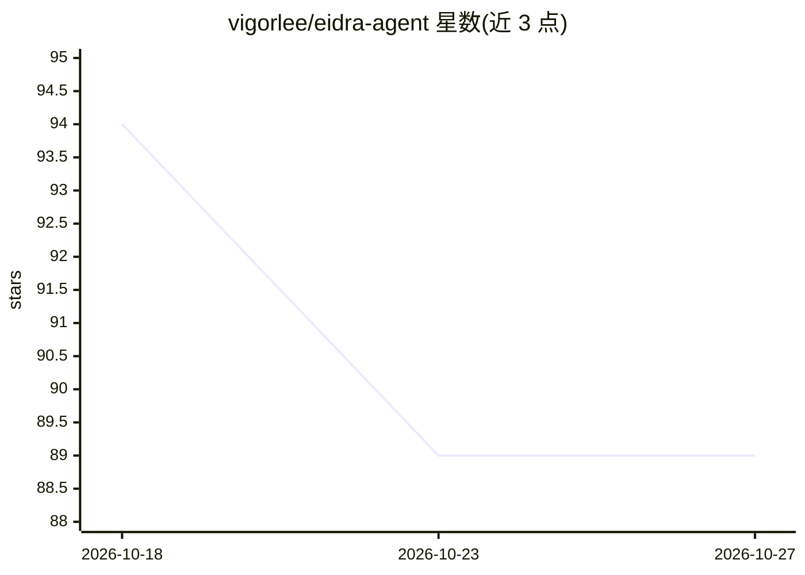

# vigorlee/eidra-agent

⭐ 89 · JavaScript · MIT · 推送 2026-09-09 · [GitHub](https://github.com/vigorlee/eidra-agent) · 个人维护 · 中文 README

**面向角色扮演、持久记忆与对抗评测的智能体 CLI 原型**

单进程本地 CLI 的 v0.1 工程原型：提供可配置的 JSON persona、显式持久记忆、基于词面重叠的确定性检索（带来源标识）、三个静态对抗评测场景，以及可导出为 SFT/DPO 用的偏好数据 JSONL。通过 Chat Completions 风格 HTTP 适配器接入本地或远程模型端点（如 vLLM），默认 mock 返回固定响应用于验证流程。检索无嵌入/向量库/重排；记忆为明文 JSON，每用户上限 100 条；无 Web UI、认证与流式。运行仅需 Node.js 内置模块，无需 GPU。

## 筛选速览

| 维度 | 判定 | 备注 |
|---|---|---|
| AI 角色 | `ai-native` | 本体是模型或模型工具 |
| 许可风险 | `permissive` | MIT |
| 部署形态 | `None` |  |
| 模型依赖 | local-ok | 支持本地模型 |
| 硬件要求 | — | 无带数字的原话,不猜 |
| 安装摩擦 | `low` | 无编译、无系统依赖或容器化 |
| 成熟度 | `idea` | |

## 能力要点

- JSON persona（身份/风格/边界）+ 显式持久记忆（/remember、/memories、/forget）
- 词面 token 重叠的确定性检索，知识记录带 id/text/source
- 三个静态对抗场景（身份漂移/虚构引用/情感支持）与关键词检查
- 偏好数据校验、去重与 JSONL 导出，面向 SFT/DPO 后训练
- Chat Completions 风格 HTTP 适配器可接入 vLLM 等兼容服务

## 适用场景

- 研究带持久记忆与可检索证据的角色扮演 agent 工作流
- 导出经审核的偏好三元组用于 SFT/DPO 实验
- 通过静态对抗场景做 agent 行为的回归调试

## 场景标签

`RAG` `Agent 记忆` `模型评测` · 领域:Agent 开发

## 证据(README 行号)

> L22: Eidra Agent explores this question through a research companion scenario. It brings configurable personas, explicit
> L24: The current release is a **runnable v0.1 CLI prototype**. It implements deterministic retrieval and a model endpoin

## 星数曲线

2026-10-18 94 → 2026-10-27 89（-5）

---
*卡片 v1 · prompt 1.4 · 生成 2026-10-23 · 置信度 high · 依据 README sha `ba37cf7c6722` · [字段定义](../../DATASET.md)*
