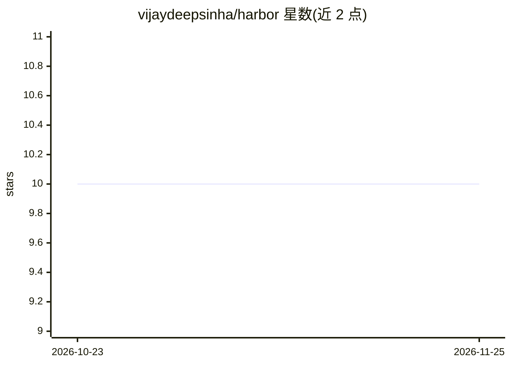

# vijaydeepsinha/harbor

⭐ 10 · TypeScript · NOASSERTION · 推送 2026-09-13 · [GitHub](https://github.com/vijaydeepsinha/harbor) · 个人维护

**MCP 网关：让 AI 客户端无需改代码接入现有后端 API**

TypeScript 实现的 Model Context Protocol 网关，在 AI 客户端（Cursor、Claude Desktop 等）与既有后端 API 之间充当适配层。采用 Code Mode 机制：AI 不逐一调用每个端点的工具，而是获得 5 个通用工具并编写 JavaScript，代码在隔离的 V8 沙箱中执行，经校验后转发至后端。支持可插拔认证（static-token、OAuth 2.1、JWT 本地 JWKS 校验）、按端点/服务的熔断器、结构化审计日志，以及 Markdown 格式的服务技能文件；后端 API 零改动。支持 Streamable HTTP 与 stdio 两种 MCP 传输。

## 筛选速览

| 维度 | 判定 | 备注 |
|---|---|---|
| AI 角色 | `ai-ecosystem` | LLM/agent 周边工具 |
| 许可风险 | `none` | NOASSERTION |
| 部署形态 | `library` | 以包/库形式分发 |
| 模型依赖 | — | README 未给出锁定关系 |
| 硬件要求 | — | 无带数字的原话,不猜 |
| 安装摩擦 | `medium` | 含编译或系统依赖之一 |
| 成熟度 | — | 结构信号不足 |

## 能力要点

- Code Mode：5 个通用 MCP 工具替代逐端点工具，AI 写代码调 API
- V8 沙箱隔离：AI 生成的代码无法访问网络、文件系统与框架内部
- 可插拔认证：static-token / OAuth 2.1 / JWT 本地 JWKS 校验
- 按端点熔断器与每次 api_execute 的结构化审计日志

## 适用场景

- 让 Cursor 或 Claude Desktop 安全访问公司内部 API
- 为大量端点的现有服务接入 AI 而不逐一封装 MCP 工具
- 需要审计与熔断的 AI-to-API 网关部署

## 场景标签

`Agent 框架` · 领域:Agent 开发

## 证据(README 行号)

> L3: A production-grade Model Context Protocol (MCP) gateway that connects AI clients to your existing backend APIs — wit
> L21: **Harbor takes a different approach: Code Mode.** Instead of one tool per endpoint, the AI gets **five general-purp
> L34: - **Five MCP tools** — `discover_services`, `discover_skills`, `get_skill_details`, `search_code`, `api_execute`

## 星数曲线

2026-10-23 10 → 2026-11-25 10（+0）

---
*卡片 v1 · prompt 1.4 · 生成 2026-11-19 · 置信度 high · 依据 README sha `44412557622f` · [字段定义](../../DATASET.md)*
