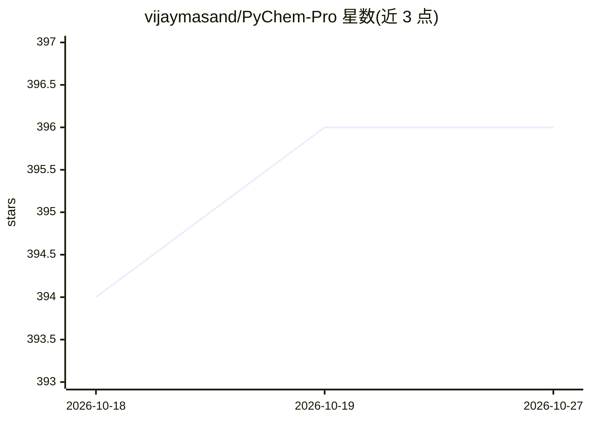

# vijaymasand/PyChem-Pro

⭐ 396 · Python · NOASSERTION · 推送 2026-10-18 · [GitHub](https://github.com/vijaymasand/PyChem-Pro) · 个人维护

**纯 Python 实现的化学桌面应用与化学信息学库**

PyChem-Pro 是基于 Python 3.10+ 与 PySide6/NumPy 的桌面化学应用及 Python 库：提供分子 2D/3D 可视化（球棍/卡通/带状）、SMILES 解析、PDB/MOL/SDF 等格式读取、MMFF94 力场优化、分子描述符与指纹计算、结构叠合、QSAR 数据划分与建模插件、化学空间可视化（PCA/t-SNE/UMAP）。不依赖 RDKit/OpenBabel，功能从零实现；含插件系统与可在 Jupyter 中使用的 pychem 公共 API。跨 Windows/macOS/Linux 运行，提供一键启动脚本或源码安装。

## 筛选速览

| 维度 | 判定 | 备注 |
|---|---|---|
| AI 角色 | `ai-enhanced` | 去掉 AI 部分产品仍成立 |
| 许可风险 | `none` | NOASSERTION |
| 部署形态 | `library` | 以包/库形式分发 |
| 模型依赖 | — | README 未给出锁定关系 |
| 硬件要求 | — | 无带数字的原话,不猜 |
| 安装摩擦 | `low` | 无编译、无系统依赖或容器化 |
| 成熟度 | — | 结构信号不足 |

## 能力要点

- SMILES/PDB/mmCIF/MOL2/SDF 读取与 MMFF94 力场优化，零化学库依赖
- PyMOL 风格蛋白质卡通渲染与 2D 结构绘制、离线光线追踪出图
- 分子描述符、Morgan/拓扑指纹、7 种 QSAR 数据划分算法
- Protocol 接口的服务化架构与插件系统，pychem 包可在无 PySide6 的 Jupyter 中使用

## 适用场景

- 在桌面端查看和分析分子结构与对接构象
- 教学场景中阅读 MMFF94 优化器等算法的纯 Python 参考实现
- 计算分子描述符并做 QSAR 数据划分与化学空间可视化

## 场景标签

 · 领域:化学/化学信息学

## 证据(README 行号)

> L4: > A pure-Python desktop application and library for chemistry and cheminformatics — molecular visualization, SMILES 
> L43: - **QSAR Data Splitting** — 7 partitioning algorithms (Random, Scaffold, CADEX, D-Optimal, Sphere Exclusion, Boruta

## 星数曲线

2026-10-18 394 → 2026-10-27 396（+2）

---
*卡片 v1 · prompt 1.4 · 生成 2026-10-21 · 置信度 low · 依据 README sha `2f2343a33af6` · [字段定义](../../DATASET.md)*
