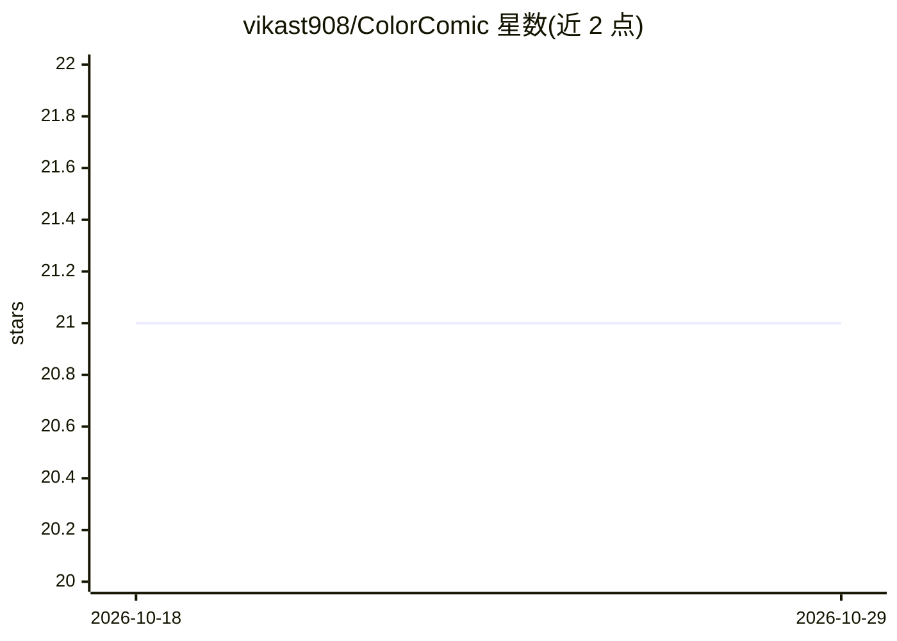

# vikast908/ColorComic

⭐ 21 · Python · MIT · 推送 2026-07-10 · [GitHub](https://github.com/vikast908/ColorComic) · 个人维护

**本地给黑白漫画/韩漫 PDF 上色的深度学习 Web 应用**

基于 Flask 的自托管应用：上传黑白漫画 PDF，用深度学习模型输出整本上色 PDF。三种模式：Auto（manga-colorization-v2 + 分割与 CLIP 引导的逐物体上色，全本地）、Reference（MangaNinja 参考页迁移上色）、LLM（OpenRouter 图像生成模型，需 API key）；另有关闭默认的纯文本 LLM 调色导演。支持 Real-ESRGAN 4 倍放大、风格预设、页内编辑与 CMYK 导出。限制：面向日漫优化、Flask 单用户、参考模式为非商业许可。需 Python 3.10+，GPU 可选（CPU 慢）。

## 筛选速览

| 维度 | 判定 | 备注 |
|---|---|---|
| AI 角色 | `ai-native` | 本体是模型或模型工具 |
| 许可风险 | `permissive` | MIT |
| 部署形态 | `library` | 以包/库形式分发 |
| 模型依赖 | locked-api |  |
| 硬件要求 | `cpu-ok` | |
| 安装摩擦 | `medium` | 含编译或系统依赖之一 |
| 成熟度 | — | 结构信号不足 |

## 能力要点

- 三种上色模式：本地 Auto、参考图 Reference、OpenRouter LLM
- 分割 + CLIP 引导实现逐物体独立配色
- Real-ESRGAN 4 倍放大与 CMYK 单页导出
- VRAM 感知模型管理，8 GB GPU 可运行

## 适用场景

- 把收藏的黑白漫画 PDF 整本转成彩色版
- 用一张彩色参考页为整本书迁移配色
- AI 上色后逐页 A/B 对比、重投与油漆桶修整

## 场景标签

`图像视频处理` · 领域:感知与多模态

## 证据(README 行号)

> L3: Colorize black-and-white comic and manga pages with deep learning — and make them
> L59: Auto mode uses manga-colorization-v2,
> L84:   → For each page: send image to an OpenRouter image model → receive colorized page

## 星数曲线

2026-10-18 21 → 2026-10-29 21（+0）

---
*卡片 v1 · prompt 1.4 · 生成 2026-10-28 · 置信度 mid · 依据 README sha `9e97d32341bd` · [字段定义](../../DATASET.md)*
