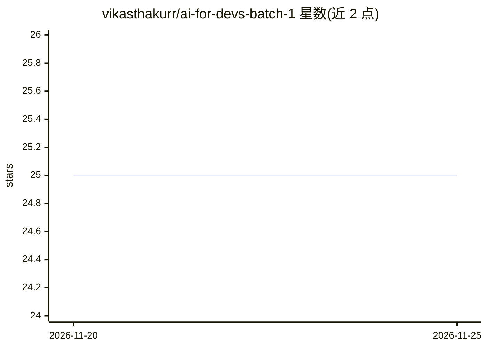

# vikasthakurr/ai-for-devs-batch-1

⭐ 25 · HTML · 推送 2026-11-19 · [GitHub](https://github.com/vikasthakurr/ai-for-devs-batch-1) · 个人维护

**面向开发者的 AI 工具与 agentic 工作流课程材料**

AI for Developers 课程仓库，内容涵盖 AI 工具使用、提示工程、agentic 工作流与 vibe coding。提供从 UI 线框到数据库集成的渐进式动手实验，涉及模块化代码组织、API 端点设计等生产模式，以及状态调试、响应式布局测试等实操排错内容。技术栈为 JavaScript/Python/HTML/CSS，需 Node.js 与 Python 环境，通过 clone 仓库并安装依赖运行。

## 筛选速览

| 维度 | 判定 | 备注 |
|---|---|---|
| AI 角色 | `ai-knowledge` | 知识聚合/清单类 |
| 许可风险 | `none` | — |
| 部署形态 | `library` | 以包/库形式分发 |
| 模型依赖 | — | README 未给出锁定关系 |
| 硬件要求 | — | 无带数字的原话,不猜 |
| 安装摩擦 | `low` | 无编译、无系统依赖或容器化 |
| 成熟度 | — | 结构信号不足 |

## 能力要点

- 从 UI 线框到数据库集成的端到端动手实验
- 覆盖提示工程、agentic 工作流与 vibe coding 主题
- 模块化代码组织与 API 端点设计等生产模式示例

## 适用场景

- 按课程实验练习 AI 辅助开发工作流
- 学习提示工程与 agentic 工作流的工程实践
- 参考仓库中的生产级代码组织模式

## 场景标签

`教程课程` · 领域:学习与行业

## 证据(README 行号)

> L14: AI for Developers curriculum — mastering AI tools, prompt engineering, agentic workflows, and vibe coding for 10x e
> L20: - **End-to-End Implementation:** Hands-on labs progressing from UI wireframing to database integration.

## 星数曲线

2026-11-20 25 → 2026-11-25 25（+0）

---
*卡片 v1 · prompt 1.4 · 生成 2026-11-20 · 置信度 high · 依据 README sha `f4d1cbf23d09` · [字段定义](../../DATASET.md)*
