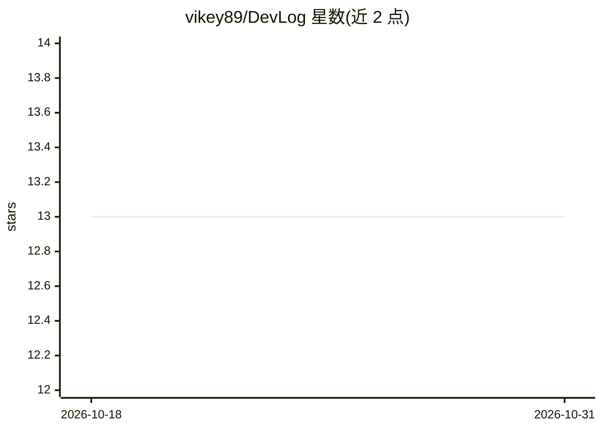

# vikey89/DevLog

⭐ 13 · Kotlin · MIT · 推送 2026-03-15 · [GitHub](https://github.com/vikey89/DevLog) · [官网](https://vikey89.github.io/DevLog/) · 个人维护

**扫描 git 提交记录、用 LLM 生成开发者日报/站会汇报的 CLI**

Kotlin 编写的命令行工具：读取本地 git 仓库的提交记录，收集当日/当周数据，调用 LLM 生成人类可读的工作摘要，支持 today/yesterday/week/standup 及自定义日期区间报告。支持 Anthropic、OpenAI、Gemini 三类 provider（Ktor 直连、无 SDK 包装），输出格式含 terminal/markdown/json/slack，可复制到剪贴板或保存文件；--raw 可跳过 LLM 仅看统计表。安装提供 shell 脚本、Release 二进制（GraalVM native）与源码编译（fat JAR 需 JDK 21）。

## 筛选速览

| 维度 | 判定 | 备注 |
|---|---|---|
| AI 角色 | `ai-native` | 本体是模型或模型工具 |
| 许可风险 | `permissive` | MIT |
| 部署形态 | `None` |  |
| 模型依赖 | locked-api |  |
| 硬件要求 | — | 无带数字的原话,不猜 |
| 安装摩擦 | `medium` | 含编译或系统依赖之一 |
| 成熟度 | — | 结构信号不足 |

## 能力要点

- 从 git 历史自动生成日报、周报与站会汇报
- 支持 Anthropic/OpenAI/Gemini provider，Ktor 直连无 SDK 包装
- 输出 terminal/markdown/json/slack 四种格式，可复制或存文件
- GraalVM native 编译二进制，shell 脚本一键安装

## 适用场景

- 每天一键生成今天做了什么的开发日记
- 站会前快速生成汇报内容
- 按自定义日期区间汇总工作产出

## 场景标签

`AI 写作` · 领域:内容生成

## 证据(README 行号)

> L11: DevLog scans your git repos, collects today's commits, and asks an LLM to write a human-readable summary. Daily rep
> L34: |Anthropic|`claude-sonnet-4-6`|`anthropic`|`ANTHROPIC_API_KEY`|docs.anthropic.com/en/docs/about-claude/models|

## 星数曲线

2026-10-18 13 → 2026-10-31 13（+0）

---
*卡片 v1 · prompt 1.4 · 生成 2026-10-31 · 置信度 high · 依据 README sha `55f89ae13918` · [字段定义](../../DATASET.md)*
