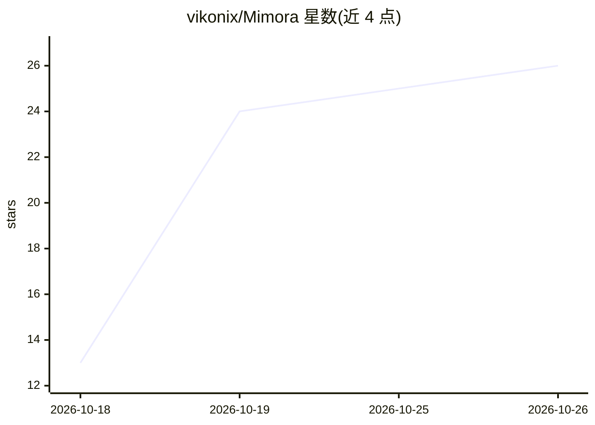

# vikonix/Mimora

⭐ 26 · Python · MIT · 推送 2026-10-25 · [GitHub](https://github.com/vikonix/Mimora) · [官网](https://github.com/vikonix/Mimora/releases) · 个人维护

**面向英语/西语学习者的本地离线发音训练器**

桌面发音训练应用：本地 LLM 从用户提供的练习文本生成短语，TTS 朗读（英语用 Kokoro、西语用 Supertonic），用户跟读后录音与参考音频比对打分（0-100 分）并标注需改进的单词。评分默认 phoneme 引擎（espeak 参考音素对 wav2vec2 识别结果），另有 acoustic 引擎；可切换 no-LLM 模式与 none 评分引擎在无模型下运行。全部在本地运行，需 16 GB RAM、无需 GPU，Windows 为主目标，macOS/Linux 亦支持。英语评分已校准，西班牙语校准尚在开发中，暂用英语校准。

## 筛选速览

| 维度 | 判定 | 备注 |
|---|---|---|
| AI 角色 | `ai-native` | 本体是模型或模型工具 |
| 许可风险 | `permissive` | MIT |
| 部署形态 | `library` | 以包/库形式分发 |
| 模型依赖 | local-ok | 支持本地模型 |
| 硬件要求 | `cpu-ok` | |
| 安装摩擦 | `medium` | 含编译或系统依赖之一 |
| 成熟度 | `idea` | |

## 能力要点

- 本地 LLM 依据用户文本生成练习短语，练习不重复
- 词级 0-100 评分并标注需改进单词，支持参考与录音对比回放
- 两种可切换评分引擎（phoneme/acoustic），可按用户声音校准
- 100% 离线运行，无云服务、无账号、无 API key

## 适用场景

- 英语或西班牙语学习者练习发音并获得即时词级反馈
- 口音矫正与影子跟读练习
- 用自己的材料（段落、歌词、剧本）生成无限练习短语

## 场景标签

 · 领域:语言学习/桌面应用

## 证据(README 行号)

> L3: **A local, offline pronunciation trainer.** Mimora speaks a phrase, you repeat it, and it scores how close you were,
> L43: 1. **Prompt** - the local LLM writes a phrase from your *practice text*, and the TTS voice of the language speaks i
> L45: 3. **Analyze** - your recording is compared with the reference, and prosody (pitch and energy) is added to the resu

## 星数曲线

2026-10-18 13 → 2026-10-26 26（+13）

---
*卡片 v1 · prompt 1.4 · 生成 2026-10-26 · 置信度 high · 依据 README sha `4f6bc7e87f94` · [字段定义](../../DATASET.md)*
