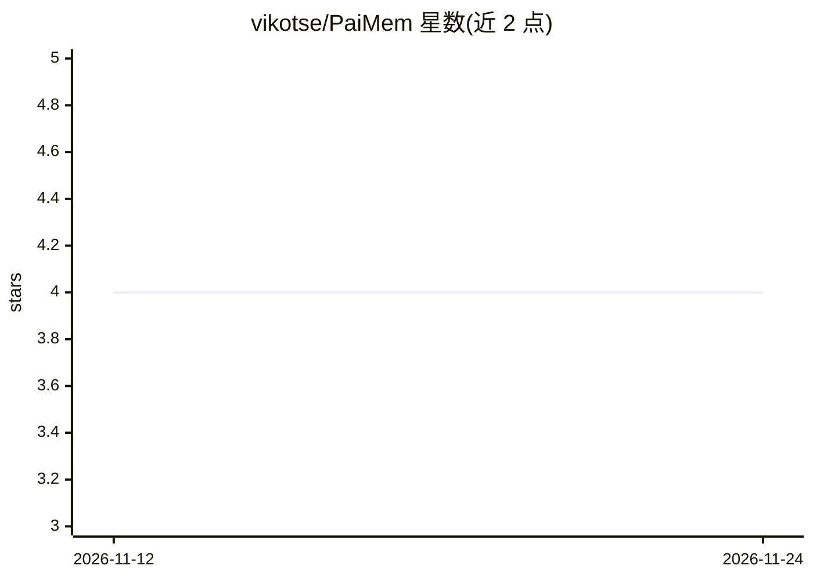

# vikotse/PaiMem

⭐ 4 · Python · MIT · 推送 2026-11-23 · [GitHub](https://github.com/vikotse/PaiMem) · 组织维护 · 中文 README

**为 LLM agent 提供可溯源长期记忆的检索服务**

PaiMem 以原始对话块存储长期记忆，在查询时通过稠密检索与 BM25 混合召回、RRF 融合、上下文感知重排、MemPursuit 证据选择与上下文重建，返回可溯源证据。提供 SQLite 持久化、按 user_id 隔离的 HTTP API（/add、/search 等），以及复现检索与端到端评测的脚本流程。默认部署为远端 embedding + 本机 vLLM 服务的重排模型，vLLM 需 Linux NVIDIA GPU 主机；SIRA 查询扩展、NEAR 残差检索等为可选策略。

## 筛选速览

| 维度 | 判定 | 备注 |
|---|---|---|
| AI 角色 | `ai-ecosystem` | LLM/agent 周边工具 |
| 许可风险 | `permissive` | MIT |
| 部署形态 | `library` | 以包/库形式分发 |
| 模型依赖 | local-ok | 支持本地模型 |
| 硬件要求 | — | 无带数字的原话,不猜 |
| 安装摩擦 | `low` | 无编译、无系统依赖或容器化 |
| 成熟度 | — | 结构信号不足 |

## 能力要点

- 混合检索：Dense + BM25 → RRF → 上下文感知重排 → 证据选择
- 证据可溯源，保留原始对话块与来源信息
- SQLite 持久化 + 按 user_id 隔离的 HTTP API
- 提供检索与端到端（生成+评审）评测脚本，支持 LoCoMo-refined 数据复现

## 适用场景

- 为多轮/长期 agent 应用接入可追溯的记忆检索服务
- 在 LoCoMo-refined 等公开数据上复现记忆检索与端到端评测
- 按 user_id 隔离存储并查询用户会话记忆

## 场景标签

`Agent 记忆` · 领域:Agent 开发

## 证据(README 行号)

> L7: PaiMem stores original conversation chunks and retrieves traceable evidence through semantic and lexical retrieval, 
> L11: PaiMem formulates long-term memory reading as **query-conditioned selection of contextual evidence**, guided by thr
> L23: SIRA query expansion, NEAR residual retrieval, role filtering, conflict-evidence checks, and long-question processi

## 星数曲线

2026-11-12 4 → 2026-11-24 4（+0）

---
*卡片 v1 · prompt 1.4 · 生成 2026-11-21 · 置信度 low · 依据 README sha `9edbd71444bc` · [字段定义](../../DATASET.md)*
