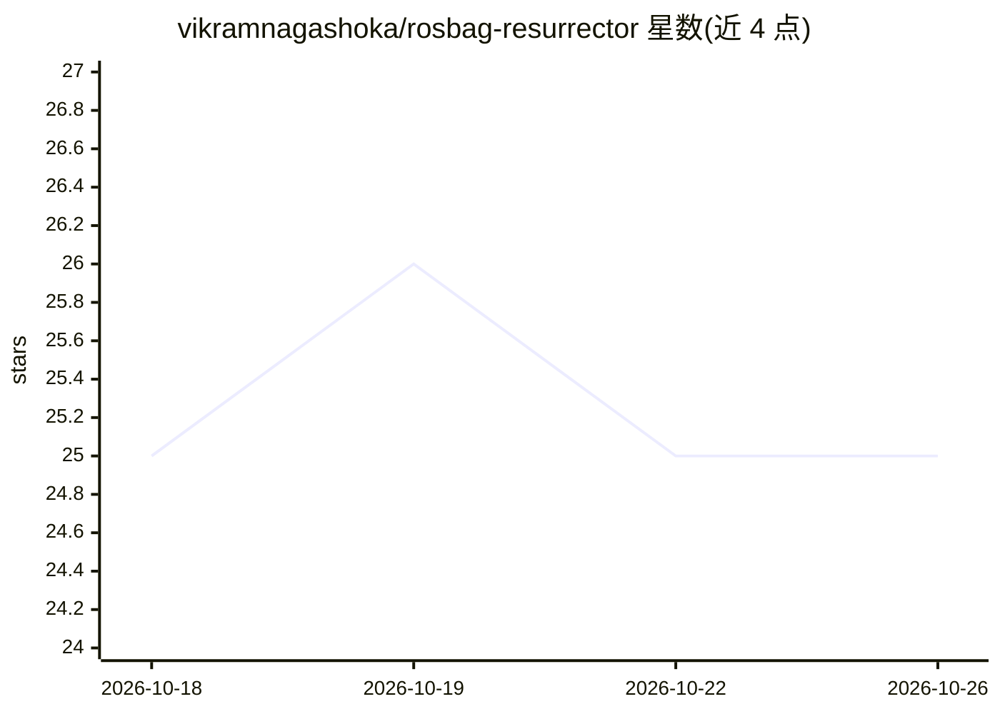

# vikramnagashoka/rosbag-resurrector

⭐ 25 · Python · MIT · 推送 2026-10-12 · [GitHub](https://github.com/vikramnagashoka/rosbag-resurrector) · 个人维护

**ROS 2 rosbag 数据的 pandas 式分析与语义检索工具**

面向机器人研究者的 ROS 2 MCAP bag 文件分析工具：无需安装 ROS，pip 即装。提供 pandas 风格 API、CLI、Jupyter 集成与 Web 仪表盘；功能含 0-100 质量健康检查（丢帧/时间断层/乱序时间戳）、多流对齐、Parquet/HDF5/CSV/NumPy/Zarr 等 ML 就绪导出、CLIP 语义帧检索（本地 CLIP 约 2GB 或 OpenAI API 两种后端，需可选安装）及 PlotJuggler 兼容 WebSocket 桥。ROS 1 .bag 转换需另装 mcap Go CLI。另附独立二进制与 25 个示例脚本。

## 筛选速览

| 维度 | 判定 | 备注 |
|---|---|---|
| AI 角色 | `ai-enhanced` | 去掉 AI 部分产品仍成立 |
| 许可风险 | `permissive` | MIT |
| 部署形态 | `desktop` | 安装包/桌面程序 |
| 模型依赖 | — | README 未给出锁定关系 |
| 硬件要求 | — | 无带数字的原话,不猜 |
| 安装摩擦 | `low` | 无编译、无系统依赖或容器化 |
| 成熟度 | — | 结构信号不足 |

## 能力要点

- bag 质量健康检查（丢帧/时间断层/乱序等，0-100 评分，阈值可配）
- pandas 风格 API + CLI + Jupyter + Web 仪表盘多种使用界面
- CLIP 语义帧检索，支持本地 CLIP 与 OpenAI API 两种后端
- 导出 Parquet/HDF5/CSV/NumPy/Zarr 等 ML 训练格式

## 适用场景

- 录制完的 rosbag 不再写一次性 CSV 脚本，直接做数据分析
- 用自然语言描述场景，在大量 bag 中检索对应视频帧
- 检测 bag 录制质量问题（丢帧、传感器断连）
- 把机器人数据导出为 ML 训练数据集

## 场景标签

`数据分析` `语义搜索` · 领域:效率与自动化

## 证据(README 行号)

> L13: A pandas-like data analysis tool for **ROS 2 (MCAP)** bag files — with automatic quality validation, multi-stream s
> L109: - **Search** — semantic frame search across all your indexed bags ("robot dropping object" → matching clips with t

## 星数曲线

2026-10-18 25 → 2026-10-26 25（+0）

---
*卡片 v1 · prompt 1.4 · 生成 2026-10-26 · 置信度 high · 依据 README sha `af791bb12457` · [字段定义](../../DATASET.md)*
