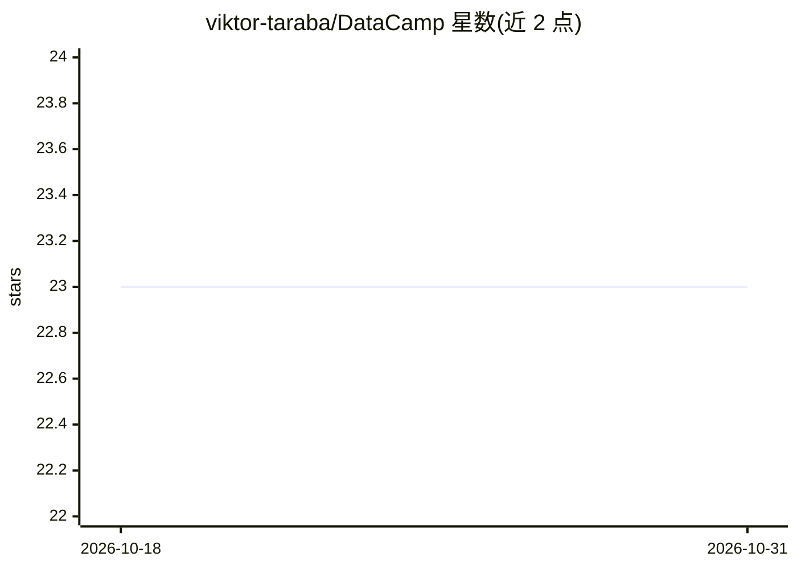

# viktor-taraba/DataCamp

⭐ 23 · Jupyter Notebook · 推送 2026-09-12 · [GitHub](https://github.com/viktor-taraba/DataCamp) · [官网](https://app.datacamp.com/learn) · 个人维护

**个人在 DataCamp 完成的课程练习与项目代码存档**

个人学习仓库，存放作者在 DataCamp 平台完成的课程练习与项目解答代码。内容以数据科学技能为主：Python（pandas、正则表达式、面向对象、统计思维）、SQL（PostgreSQL、SQL Server）、Power BI（DAX、数据建模、报表设计）、Shell 数据处理，以及基于树的机器学习模型和 Airflow 入门等。README 以两张表格列出课程与项目名称及完成状态（Done/In progress），不提供安装运行方式，各练习需自行从仓库目录查阅。

## 筛选速览

| 维度 | 判定 | 备注 |
|---|---|---|
| AI 角色 | `ai-knowledge` | 知识聚合/清单类 |
| 许可风险 | `none` | — |
| 部署形态 | `None` |  |
| 模型依赖 | — | README 未给出锁定关系 |
| 硬件要求 | — | 无带数字的原话,不猜 |
| 安装摩擦 | `low` | 无编译、无系统依赖或容器化 |
| 成熟度 | — | 结构信号不足 |

## 能力要点

- 33 门 DataCamp 课程的练习代码，含完成状态表
- 覆盖 pandas/SQL/Power BI/Python 等数据科学课程
- 含 8 个以上数据分析项目（如夏普比率、国际债务统计）的解答

## 适用场景

- 查阅同类 DataCamp 课程的练习思路与参考解答
- 了解 pandas、SQL、Power BI 等课程的实际练习内容

## 场景标签

 · 领域:数据科学/学习资源

## 证据(README 行号)

> L1: ## Datacamp Courses ##
> L39: ## Datacamp Projects ##

## 星数曲线

2026-10-18 23 → 2026-10-31 23（+0）

---
*卡片 v1 · prompt 1.4 · 生成 2026-10-27 · 置信度 low · 依据 README sha `559c4a30bc5a` · [字段定义](../../DATASET.md)*
