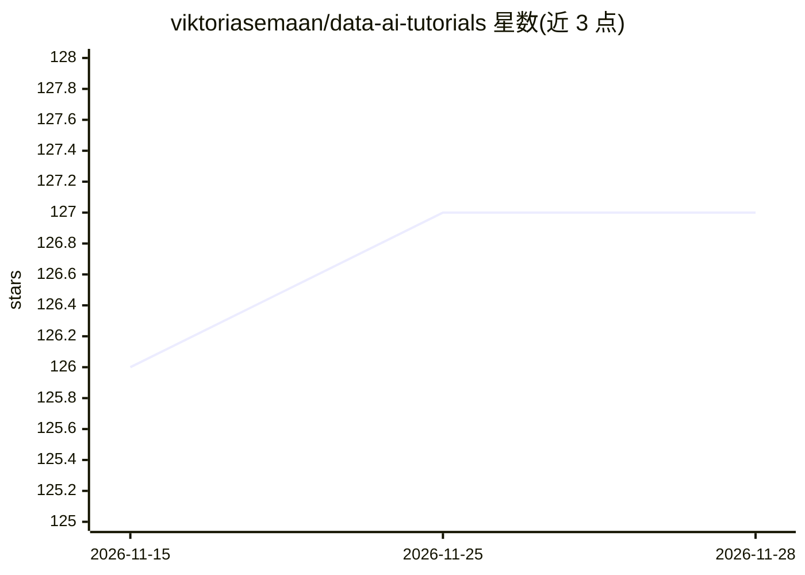

# viktoriasemaan/data-ai-tutorials

⭐ 127 · Jupyter Notebook · MIT · 推送 2026-11-20 · [GitHub](https://github.com/viktoriasemaan/data-ai-tutorials) · 个人维护

**面向数据与 AI 工程者的 lakehouse 与 AI agent 教程集**

以系列教程形式组织的数据工程与 AI agent 项目集，项目递进：先搭建基于 Spark/Delta Lake/Unity Catalog 的 lakehouse，再通过 MCP 接入 AI/BI Genie 自然语言查询，进而实现 LangGraph agent 记忆、agent harness 成本对比（Claude Code/Codex/Hermes 经 Unity Gateway）与 LLM 蒸馏（teacher→LoRA 微调 student→MLflow 评估→Model Serving）。每个教程附完整步骤、示例数据与架构图，面向从业者和解决方案架构师，MIT 许可。

## 筛选速览

| 维度 | 判定 | 备注 |
|---|---|---|
| AI 角色 | `ai-knowledge` | 知识聚合/清单类 |
| 许可风险 | `permissive` | MIT |
| 部署形态 | `None` |  |
| 模型依赖 | — | README 未给出锁定关系 |
| 硬件要求 | — | 无带数字的原话,不猜 |
| 安装摩擦 | `low` | 无编译、无系统依赖或容器化 |
| 成熟度 | — | 结构信号不足 |

## 能力要点

- 5 个递进式教程：lakehouse→MCP 接入→agent 记忆→harness 成本对比→蒸馏
- agent harness 教程在同一模型上对比三种 harness 的每任务成本
- 蒸馏教程含 teacher 标注、LoRA 微调、MLflow 评估与 Model Serving 部署
- 每项目提供完整教程、示例数据与架构图

## 适用场景

- 学习在 Databricks 上从零搭建 lakehouse
- 为 agent 添加会话与语义记忆（Lakebase）
- 评估不同 agent harness 的成本差异
- 将大模型蒸馏为小模型自部署服务

## 场景标签

`教程课程` · 领域:学习与行业

## 证据(README 行号)

> L7: The projects build on each other: a governed **lakehouse** holds the data, **AI agents** reach it through **MCP**, *
> L48: 👋 **About:** This portfolio showcases hands-on data engineering and AI agent projects designed for practitioners an

## 星数曲线

2026-11-15 126 → 2026-11-28 127（+1）

---
*卡片 v1 · prompt 1.4 · 生成 2026-11-28 · 置信度 high · 依据 README sha `8d8b35933a92` · [字段定义](../../DATASET.md)*
